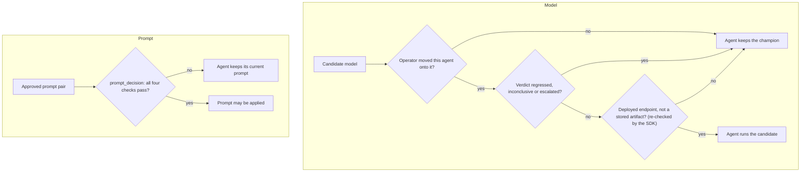

Nothing reaches your users until a person approves it. This page explains every gate between a trained candidate and your production agent, and the controls in Mission Control that move it.

**Both halves of an improvement, the model and the prompt, require a human decision.** Not a threshold, not a scheduler, and not a language model reading a report and deciding it looks good.

## Champion and candidate

Your agent keeps serving the model it is on today, the **champion**. Training produces a **candidate**, and every candidate is measured against the model you run today. A new version reaches **Decisions** in Mission Control only after it has beaten your agent's current best on conversations it has never seen.

<Image src="https://raw.githubusercontent.com/percepteye-ai/agent-flywheel/main/docs/assets/control-plane-agent.png" alt="A sample agent's page in Mission Control: it runs the champion, with a Try the candidate button, and a candidate-versus-base table showing two improved verdicts with mean-reward and pass-rate gains." width="920" height="507" />

*A sample agent's page. Nothing moves until a person clicks Try the candidate, and moving back is the same kind of click.*

## The gates



Every branch that is not a clear yes falls back to what your agent already runs.

## The model: three conditions, each failing closed

Your agent leaves the champion only when **all three** hold. If any one does not, it stays on the champion.

<Steps>
<Step title="A person with the operator role moves that agent" icon="user-check">

`POST /flywheel-agents/{agent_id}/policy-channel` requires the operator role and a signed-in human identity. The `pefw_` key your agent uses cannot make this call at all.

No promotion applies it, no percentage rollout applies it, and there is no automatic path to it. Moving back is the same call with the other value, which is what makes rollback fast enough to use during an incident.

</Step>
<Step title="The candidate's certification did not go against it" icon="shield">

A verdict of `regressed`, `inconclusive` or `escalated` makes the candidate unservable. That is the same list the promotion gate refuses on, so an agent can never be served a model the promotion path would have rejected.

</Step>
<Step title="It is actually deployed somewhere your agent can call" icon="server">

An address that is a stored artifact rather than a running endpoint (`gs://`, `s3://`, `file://`, or an absolute path) is refused, so an approved candidate nobody has served yet keeps the champion in place instead of pointing your agent at something that answers nothing.

**The SDK re-checks this itself** rather than trusting the answer. In Python, `endpoint_kwargs()` (the one place a served policy becomes client arguments, used by both `apply_current_policy()` and `policy_source()`) returns `{}` and logs why. The Node plugin refuses the same prefix set and logs its own reason.

</Step>
</Steps>

## The prompt: a separate approval chain

The prompt has its own approval. The control plane serves a prompt only from a delivery a person approved (status `approved` or `delivered`), and the SDK re-checks that status on your side before anything is applied.

`prompt_decision()` is the whole rule in one call. It refuses for four distinct reasons, each naming its own cause:

| it refuses when | because |
|:--|:--|
| there is no text to apply (`{}`, missing, or blank) | nothing has passed the approval gate, or the control plane could not answer: the prompt you already have stands |
| `stale_baseline` is `true` | your own baseline prompt changed after the pair was certified, so the approved text was shaped against a prompt you no longer ship |
| `status` is not `"approved"` or `"delivered"` | only a bundle a person approved is applied |
| `sha256` and `model_prompt_checksum` are both present and differ | the bundle disagrees with itself, so it is not the pair that was validated |

```python
served = fw.current_prompt(agent_id="support-agent")
decision = fw.prompt_decision(served)     # may it be applied, and if not why
if decision.apply:
    system_prompt = decision.text         # never None here
else:
    log.info("keeping the current prompt: %s", decision.reason)
```

`apply` is false unless all four checks hold, `reason` says which one failed, and `text` is `None` rather than `""` on a refusal, so assigning it can never blank the prompt your agent runs on. The Node plugin asks the identical question, and one parity test drives a shared table of cases through both implementations.

The prompt and the model were certified **together**. When only one half lands, the Node plugin's startup log warns and names which half is missing and why, because half of a validated combination is not the improvement anybody measured.

## No language model can approve

Promoting a model, delivering a prompt pair, and promoting a research result (`model_promotion`, `prompt_pair_delivery`, `research_promotion`) are all classed as irreversible decisions in the control plane. Only the explicit approve or reject control can resolve them.

A model reading free-form text and interpreting "sure, go ahead" as consent, in a chat thread, a document, or anywhere else, is recorded as *answered* and never as *approved*. It cannot promote, deliver, or roll anything out.

## In Mission Control

Sign in at [launch.percepteye.ai](https://launch.percepteye.ai).

<Steps>
<Step title="Approve the winner in Decisions" icon="check-circle">

**Decisions**, in the sidebar. A new version comes here only after it has beaten your agent's current best on conversations it has never seen. Approve it or reject it; nothing else decides.

</Step>
<Step title="Try a new version on one agent" icon="play">

Your agent's page, its **Agent** tab → **Try the candidate**.

</Step>
<Step title="Move back" icon="git-branch">

**Move back to champion** undoes it.

</Step>
</Steps>

Every click path is listed on [Mission Control](/mission-control).

## How a decision reaches your agent

| | Python SDK | Node plugin |
|:--|:--|:--|
| the model | handed back as an endpoint: `apply_current_policy()` once at startup, or `policy_source()` per turn | applied for you in production mode, through a provider the plugin registers (`percepteye-flywheel`) |
| the prompt | handed back by `current_prompt()`; you apply it after `prompt_decision()` | applied for you in production mode, by replacing the prompt your host assembled |
| when it is read | `policy_source()` refreshes inside your own call once its answer is about five minutes old, or sooner when the control plane asks, never more often than every 30 seconds | once, at startup; restart the gateway to pick up a new version |
| a rollback | reaches production with no redeploy | takes effect at the next start |
| training mode | not applied by `serve()`; rollouts sample through the per-rollout gateway | neither half is applied |

**An empty answer always means "keep what you run", never "run with nothing".** When the control plane withdraws a model (`withdrawn: true`), `policy_source()` reverts to the configuration it was constructed with, and the Node plugin lets the model your host configures stand from the next start.

After its first success, `policy_source()` keeps serving the last good policy when a refresh fails, so a network blip can never silently move production back to the untrained model. See [Production capture](/production) and [Training and production](/modes).
