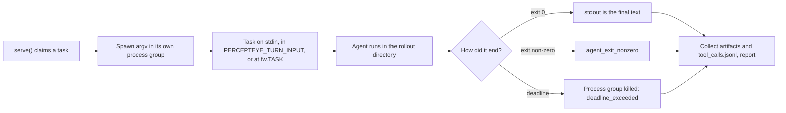

Pass an argv list instead of an import path and `serve()` runs your agent as a process: a compiled binary, a Node CLI, anything with a command line. There is no protocol to implement, so an existing CLI needs no changes.

```python
import agent_flywheel as fw

fw.serve(["my-agent", "run"], agent_id="support-agent", input_shape="text")
```

A `list` or `tuple` first argument means the agent is a process, not an object. Nothing is imported or resolved, isolation is inherent, and `method=` and `adapters=` have no object to apply to. Installing the SDK and getting a key are the same as for the [Python SDK](/python-sdk); every `serve()` argument is in the [Python API reference](/reference/python).

<Callout kind="tip">

Running goose yourself rather than lending capacity? Skip the worker process and install the hooks, as shown in the goose section below.

</Callout>

## One practice task, as a process



## The task, three channels

| channel | when | notes |
|:--|:--|:--|
| **stdin** | always, unless `fw.TASK` is in the argv | written, then closed |
| **`PERCEPTEYE_TURN_INPUT`** | always | inert unless the CLI reads it |
| **an argv position** | only where `fw.TASK` appears | every occurrence is substituted |

The first two are sent together because CLIs differ and guessing wrongly is silent. With `fw.TASK` in the argv, stdin gets the empty string, so an agent that reads both does not act on the same instruction twice.

`fw.TASK` is a sentinel object, not the string `"{task}"`, so a literal argument containing that text survives verbatim:

```python
fw.serve(["agent", "--tmpl", "{task}", fw.TASK], ...)
# argv:  agent --tmpl {task} count to three
```

The argv goes to `Popen` as a list, never through a shell, so a task containing `oops"; rm -rf / #` is one argument.

<Callout kind="alert">

**argv is visible; stdin is not.** Anything in an argv is readable by other users on the machine through `ps`. The task text is your agent's prompt, so `fw.TASK` publishes it to the process table. Use it only when the CLI cannot read stdin or an environment variable.

</Callout>

## What comes back

For an ordinary command, **stdout, trimmed, is the final text**. Structured output is interpreted only when you pass an explicit `command_output_adapter` (see below).

| what happened | `exclusion_reason` | reported? |
|:--|:--|:--|
| exit 0 | none | yes |
| exit non-zero | `agent_exit_nonzero`; the detail is `exit <n>: ` plus the last 1500 characters of stderr | yes, carrying the exclusion |
| killed on the deadline | `deadline_exceeded`; the detail names the timeout and the last 1500 characters of stderr | yes, carrying the exclusion |
| the binary could not be started | n/a | no: the spawn raises and the rollout is abandoned as `flywheel_crash` |

**Excluded is not discarded.** A rollout that wrote a correct deliverable and then exited 1 is still reported, so the control plane keeps the work product and knows not to train on it. `agent_exit_nonzero` is deliberately separate from a launch failure: reaching a non-zero exit means the agent ran and chose it. On a clean exit stderr is dropped, so anything you want kept goes on stdout or into a file.

## The working directory is the rollout

Each child starts in its own rollout directory, `<artifacts_dir>/_percepteye/<rollout_id>`, the same path it gets as `PERCEPTEYE_TRAJECTORY_DIR`. For a coding or REPL agent the files it leaves there are the deliverable, so every one is collected as an artifact, on every exit path including a timeout kill. The directory is removed once the report is out.

- `tool_calls.jsonl` is the trajectory, not an artifact.
- **Symlinks are never followed.** One is recorded as `skipped:symlink`, because `ln -s ~/.aws/credentials creds.txt` would otherwise be read at its target.
- Files over 256 MB are recorded as `skipped:too_large:<size>`. Up to 64 KB of UTF-8 per file, and 256 KB per report, is inlined; the rest travels as a digest.

<Callout kind="danger">

`artifacts_dir` defaults to `$PWD/.percepteye-artifacts`. A CLI agent has a real shell, and isolation here is a process boundary and an environment scrub, not a filesystem sandbox. **Point `artifacts_dir=` outside any checkout.**

</Callout>

## The child's environment

| variable | value |
|:--|:--|
| `PERCEPTEYE_ROLLOUT_ID` | this rollout's id |
| `PERCEPTEYE_TRAJECTORY_DIR` | this rollout's directory, also the working directory |
| `PERCEPTEYE_TURN_INPUT` | the task |
| `OPENAI_BASE_URL` · `OPENAI_API_BASE` · `ANTHROPIC_BASE_URL` | the per-rollout gateway |
| `OPENAI_API_KEY` · `ANTHROPIC_API_KEY` | the rollout's single-use key |

Your environment otherwise passes through, because your agent needs your credentials. Two things never do: the inherited `PERCEPTEYE_` namespace, where the long-lived control-plane key lives, and provider variables the gateway cannot serve (Azure, Gemini and Vertex, Bedrock's bearer token, and the OpenAI-compatible resellers). `serve()` warns at startup if it finds any.

### `endpoint_env`: when your agent reads other names

```python
fw.serve(["dsh", "--profile", "headless", fw.TASK],
         agent_id="support-agent", input_shape="text",
         endpoint_env=("DEEPSEEK_BASE_URL", "DEEPSEEK_API_KEY"))
```

The named pair receives the same per-rollout URL and key. It is additive: the OpenAI and Anthropic names stay set, because an agent may read a mixture. It is declared, never sniffed: an agent that reads neither default looks correctly routed right up until its completions reach the live provider unobserved.

### `gate_flag`: how your binary spells its completion gate

```python
fw.serve(ARGV, ..., gate_flag="--autonomous-gate")
```

`gate_flag` is a property of the binary and cannot be guessed. The gate command is a property of the task and arrives per rollout in `metadata["completion_gate"]`. With both present, the two are appended to the argv; either missing leaves it untouched.

```text
prime-agent … --autonomous-gate 'test -s top_ips.sh'
```

## Timeouts kill the process group

`rollout_timeout_s` (default `900.0`) is capped by the rollout's remaining budget less 10 seconds, held back so artifacts and the report still land on a live lease. On expiry the whole **process group** is killed with `SIGKILL`.

The group, not the process: a real CLI agent spawns a shell, a compiler, a test runner, and killing only the launched process leaves those holding the stdout pipe open. On POSIX the child starts in a new session, so a spawning agent leaves nothing behind. Windows has no process groups, so only the launched process is killed.

## Tool outcomes with no instrumentation

Two routes in. Neither needs a line of code inside the agent.

### 1. An adapter for the stream your CLI already prints

Pass a `command_output_adapter` to interpret stdout after every run. It is an object with an `adapter_name` and a `project(stdout)` method that returns a `CommandOutputProjection`. With no adapter, core treats stdout as final text and claims no tool or model-call evidence. The generic `StreamFormat` parser can reconcile tool start and end events, and its `OTEL_GENAI` vocabulary (`gen_ai.tool.start` / `gen_ai.tool.end`) belongs to no vendor.

| the end event carries | outcome |
|:--|:--|
| the error flag as `true`, or a non-empty string | `failed` |
| the error flag as `false` | `ok` |
| an empty string, or no error flag at all | `unknown` |

`unknown` is never rounded up to `ok` ([Outcomes](/outcomes)), and `status_code` is always `null` here. A call with no resolvable name is dropped, not invented. Only stdout is read. Adapter capture survives a clean exit, a non-zero exit and a timeout kill: a rollout that died is the one whose tool calls you most need.

### 2. Append to the trajectory from a shell

```bash
printf '{"name":"deploy","arguments":{"env":"prod"},"outcome":"ok","status_code":201}\n' \
  >> "$PERCEPTEYE_TRAJECTORY_DIR/tool_calls.jsonl"
```

One JSON object per line. `name` and `outcome` (`ok`, `failed`, `unknown`) are required; `arguments`, `status_code`, `output`, `error`, `error_class`, `latency_ms`, `agent_name`, `tool_call_id` and `entity_ids` are optional. One unreadable line costs that line and nothing else, and is counted in `tool_calls_omitted_count`. **The trajectory wins:** if anything was recorded there, including `[]`, the stream is not consulted.

## goose: hooks instead of a worker

If you run [goose](https://github.com/aaif-goose/goose) yourself, you need no worker process. The hook plugin ships inside the Python wheel.

<Steps>
<Step title="Install the SDK" icon="download">

```bash
pip install agent-flywheel
```

</Step>
<Step title="Install the hooks" icon="plug">

```bash
agent-flywheel install-hooks
```

It renders the goose plugin, pointed at this virtualenv's interpreter. `--force` replaces a plugin directory it did not install.

</Step>
<Step title="Start goose as before" icon="play">

In training mode (the default), with `PERCEPTEYE_CONTROL_PLANE_URL` and `PERCEPTEYE_API_KEY` set, each session claims one practice task when a run has one for this agent (`PERCEPTEYE_AGENT_ID`, default `goose`), finds it in its working directory as `PERCEPTEYE_TASK.md`, and is reported as that task's result. With `PERCEPTEYE_AGENT_MODE=production` the hooks claim and report nothing, and goose keeps its own endpoint.

</Step>
<Step title="Check where it stands" icon="activity">

```bash
agent-flywheel status
```

Prints whether the plugin is installed and current, the mode, where goose's model traffic goes on its next session, and whether rollouts are claimed (and if not, why). A mode change takes effect on goose's next session.

</Step>
<Step title="Read your tool-failure rate" icon="gauge">

```bash
agent-flywheel report
```

Prints the real tool-failure rate recorded for the most recent session, or for a trajectory directory you name. Outside a rollout the hooks record under `$PERCEPTEYE_HOME/turns/<session>`; `PERCEPTEYE_CAPTURE=0` turns recording off.

</Step>
</Steps>

To lend goose to practice tasks from a worker instead, see [`examples/goose`](https://github.com/percepteye-ai/agent-flywheel/tree/main/examples/goose): it serves goose as a command and closes two ways goose can route past the gateway (`OPENAI_HOST` outranks `OPENAI_BASE_URL`, and `GOOSE_PROVIDER` can select another provider).

## Worked example: prime-agent

[`examples/prime_agent`](https://github.com/percepteye-ai/agent-flywheel/tree/main/examples/prime_agent) serves a real TypeScript coding agent end to end, with no Agent Flywheel code inside it. It is an optional example adapter, not SDK default behavior.

| piece | why |
|:--|:--|
| `--mode json` with `PrimeAgentOutputAdapter()` | projects Prime's tool, assistant and call-lifecycle evidence from stdout |
| `-e route.ts` | prime-agent has no base-URL variable; an extension reads `OPENAI_BASE_URL` and registers a provider |
| `--provider percepteye --model …` | registering a provider does not select it |
| `--no-session` | stops one rollout's harness refinement from changing later ones |
| `gate_flag="--autonomous-gate"` | without a gate, a limit is the only exit, and every rollout ends excluded |
| `artifacts_dir=` outside any checkout | the agent has a shell |

## What argv does not give you

- **No Python object adapters.** `adapters=` binds to a Python object; use `command_output_adapter=` or the trajectory file.
- **No `method=` and no `input_shape` shaping.** A command always receives the raw task text.
- **No `record_tool_call()`.** That is an in-process call; append JSONL instead.
- **No filesystem sandbox.** Run untrusted agents accordingly.

Running OpenClaw or DeepSeek Harness? Those load the [Node plugin](/node-plugin) instead.
