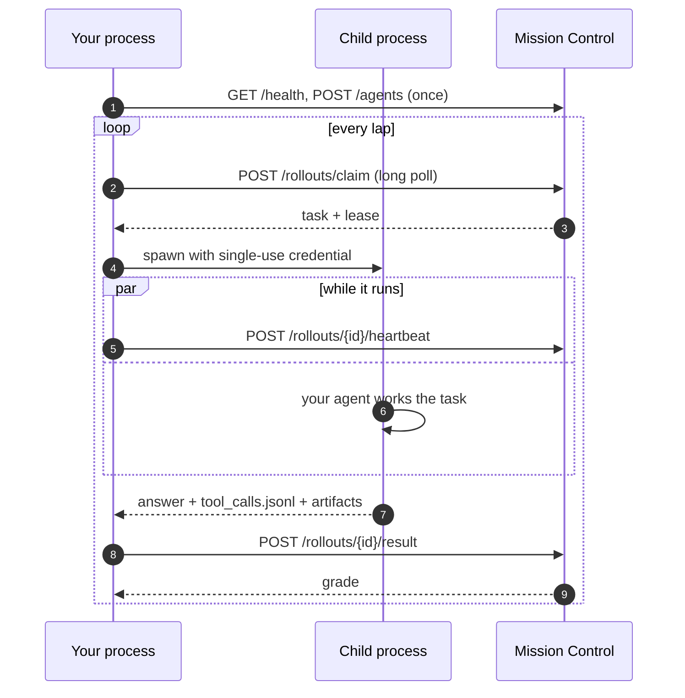

## A loop that closes on its own

Your agent already does real work. Agent Flywheel turns that work into training data and delivers what it learns back as an endpoint your agent already knows how to call. The last step is what makes it a flywheel rather than a pipeline: **the better agent generates the better evidence**, and each round starts from the best so far.

<Image src="https://raw.githubusercontent.com/percepteye-ai/agent-flywheel/main/docs/assets/flywheel-loop.gif" alt="On the left, inside your infrastructure: install, the harness, your agent unchanged, and its trajectory. A dashed trust boundary runs down the middle. On the right, Mission Control generates tasks from your tool surface, scores every rollout, trains the policy, and hands a candidate back as an endpoint you can call." width="1280" height="720" />

## Two sources of evidence

The loop learns from two kinds of evidence. You can use either or both.

| | Live conversations | Practice tasks |
| --- | --- | --- |
| What it is | The turns your agent already serves to real users | Tasks Mission Control writes from your agent's own tools, which your agent works through and which are graded |
| Python | `fw.attach()` | `fw.serve()` |
| OpenClaw | Plugin in `production` mode | Plugin in `training` mode |
| goose | | `agent-flywheel install-hooks`, in training mode |
| No SDK | [OpenTelemetry push](/opentelemetry) | |
| Leaves your machine | Only once an operator allows it, per agent | Each graded result, as it finishes |
| Graded | Advisory: they inform training | Against compiled checks |

## The beats

| Beat | What happens | Who does the work |
| --- | --- | --- |
| **Onboard** | The SDK describes your agent from inside its own process and registers it, once | Automatic. `introspect=False` opts out. |
| **Claim** | Your process long-polls for a practice task and is granted a lease | You dial out |
| **Run** | A fresh child process with its own environment and a single-use credential | Your agent, unchanged |
| **Record** | Every tool call lands as `ok`, `failed` or `unknown`; artifacts are collected on every path | Adapters, from the outside |
| **Score and train** | Tasks are generated from your real tool surface, graded, and a policy is trained | Mission Control |
| **Approve** | Each candidate is tested against your current model; a person approves the winner | You, in **Decisions** |
| **Improve** | Your production agent picks up the approved model and prompt; the next lap runs on the better agent | One call, or automatic in OpenClaw |



## Onboard: the agent describes itself

A connector that reads source code or a manifest sees what your agent might do. This one runs **inside the process holding the constructed agent**, so it reads the prompt after its template rendered, the tools after conditional registration, and the sub-agents after the graph was assembled. That is why you never write a task list: tasks come from the tool surface you actually have.

<Expandable title="What is read, and what is never sent" default-open="false">

Read once at startup: the system prompt, tool names, descriptions and JSON Schemas, provider and model name, sub-agents to depth 4, and the framework matched.

Never sent: your tools' source or return values, your credentials, your data, or anything observed during a rollout.

An agent nothing can read (a custom class, a framework the SDK does not know) declares itself with `describe={"system_prompt": ..., "tools": [...]}`. Turn discovery off with `fw.serve(..., introspect=False)` or `PERCEPTEYE_INTROSPECT=0`.

</Expandable>

## Claim: a long poll you open

`serve()` is pull-only. Your process asks for work; nothing pushes to it. An empty queue answers with an empty list and a server-chosen `poll_after_ms`, so you can tell an idle queue from a broken route:

| `on_event` kind | Means |
| --- | --- |
| `claim_empty` | The claim succeeded and the queue is empty |
| `claim_failed` | The claim itself failed. The SDK sleeps 5 s and keeps trying |

A claim grants a lease, 30 minutes by default. A heartbeat thread renews every in-flight lease at a third of the granted lease, so two beats can be lost before anything lapses. If the lease is lost, the child is killed. A crashed worker needs no cleanup: the lease expires and the task goes to the next claimer.

## Run: isolate, then route

Each practice task runs in a fresh child process. The default isolation is `subprocess`, the only mode with a real timeout.

1. **No `PERCEPTEYE_` variable is inherited.** Your long-lived key stays in the parent.
2. **Two rollout-scoped values are set:** `PERCEPTEYE_ROLLOUT_ID` and `PERCEPTEYE_TRAJECTORY_DIR`.
3. **The per-rollout endpoint and its single-use key are set last**, so they beat anything inherited: `OPENAI_BASE_URL`, `OPENAI_API_BASE`, `OPENAI_API_KEY`, `ANTHROPIC_BASE_URL`, `ANTHROPIC_API_KEY`.

Provider variables the gateway cannot serve, such as `AZURE_OPENAI_*`, `GOOGLE_API_KEY` or `GROQ_API_KEY`, are removed from the child, and `serve()` warns at startup if it finds any. An unobserved model call cannot be trained on, so the SDK refuses to let one happen silently.

## Record, then report

Adapters record every tool call from outside your agent. Then every rollout is reported, whatever happened to it: a run that went badly carries a typed exclusion, so Mission Control keeps the work product and knows not to train on it.

| Exclusion | Means |
| --- | --- |
| `entrypoint_error` | The Python entrypoint raised. Nothing usable ran. |
| `agent_exit_nonzero` | The agent ran and exited non-zero. Its own failure, and evidence. |
| `deadline_exceeded` | The budget ran out before or during the run |
| `credential_expired` | The lease lapsed mid-flight and the child was killed |
| `substrate_unavailable` | Every observed tool call failed: the environment was down, not the agent |
| `flywheel_crash` | The SDK's own failure |

The result is spooled to disk **before** it is sent, so a process killed mid-request still delivers, and held results go out before more work is claimed. See [Outcomes](/outcomes) for why `unknown` is never rounded up to `ok`.

## Score and train: the part you do not build

Grading happens in Mission Control, against tasks generated from the tool surface your agent reported. Training co-optimizes the system prompt with the model. You can inspect every generated task, every score and every candidate in [Mission Control](/mission-control).

## Improve: the better agent runs the next lap

`serve()` prints the current policy at startup and deliberately does not apply it, because a practice run must sample through its own gateway to be captured. Your production agent is where the approved version is applied:

<CodeGroup tabs="Python,OpenClaw">

```python
policy = fw.policy_source(agent_id="support-agent")
snap = policy.current()            # per turn; a cache read between refreshes
if snap.changed:
    client = OpenAI(base_url=snap.base_url, api_key=snap.api_key)
    model = snap.model
```

```json
{
  "plugins": {
    "entries": {
      "agent-flywheel": {
        "hooks": { "allowConversationAccess": true },
        "config": { "mode": "production" }
      }
    }
  }
}
```

</CodeGroup>

In Python, nothing polls in the background, and after its first success `policy_source()` keeps serving the last good policy, so a network blip cannot silently move production back to the old model. In OpenClaw, a production install reads the approved prompt and model once at startup and applies both. Either way, only a version a person approved is ever served: see [Human approval](/approval).

## Guarantees

<Columns cols={2}>
  <Card title="Zero lines changed" icon="code">

  Adapters bind from the outside. A test asserts a LangChain agent with no Agent Flywheel import still reports every tool call.

  </Card>
  <Card title="Outbound only" icon="shield">

  Nothing dials in to your side. Every lane is a request your process makes. [Security and network](/security)

  </Card>
  <Card title="Honest evidence" icon="circle-check">

  `unknown` is a legal answer and is never counted as success. [Outcomes](/outcomes)

  </Card>
  <Card title="Fails open" icon="activity">

  An unreachable Mission Control costs you the observation and nothing else. Your agent keeps serving.

  </Card>
</Columns>
