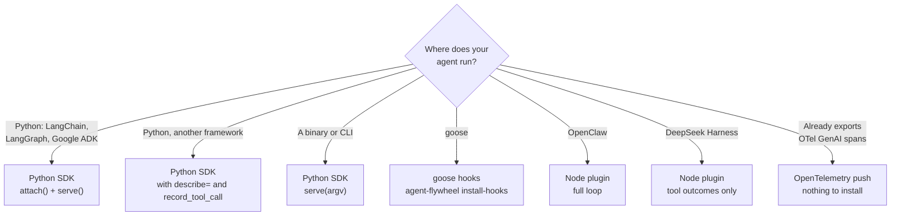

## Find your path in ten seconds



## What each one can do

| Integration | Records tool outcomes | Practice tasks | Captures live turns | Approved prompt | Approved model |
| --- | --- | --- | --- | --- | --- |
| [Python SDK](/python-sdk) | Yes, through adapters | Yes, `serve()` | Yes, `attach()` | Returned by `current_prompt()` for you to apply | Returned as an endpoint for you to call |
| [OpenClaw plugin](/node-plugin) | Yes, `after_tool_call` | Yes, in `training` mode | Yes, in `production` mode | Applied for you | Applied for you |
| [DeepSeek Harness plugin](/node-plugin) | Yes, `tools/result` | No | No | No | No |
| [goose hooks](#goose) | Yes | Yes, in `training` mode | Recorded locally | No | No |
| [Any CLI agent](/cli-agents) | With an explicit output adapter, or by appending to the trajectory | Yes, `serve(argv)` | No | No | No |
| [OpenTelemetry push](/opentelemetry) | From your spans | No | Yes | No | No |

<Callout kind="alert">

Pick one integration per agent. Python or Node, never both. And send each conversation one way only: pushed spans and uploaded turns are both kept, so the same traffic sent twice is learned from twice.

</Callout>

## Python SDK

For agents that run in Python. The LangChain, LangGraph and Google ADK adapters bind automatically, with no Agent Flywheel code inside your agent.

```bash
pip install agent-flywheel
```

| Method | Use it for |
| --- | --- |
| `attach()` | Record the turns your agent already serves in production |
| `serve()` | Run practice tasks in a fresh child process per task |
| `policy_source()`, `apply_current_policy()` | Point your client at the approved model |
| `current_prompt()`, `prompt_decision()` | Read the approved prompt and check it may be applied |
| `record_tool_call()` | Assert a tool's outcome where you know the answer |

Python 3.10 to 3.13. One runtime dependency, `httpx`. Full guide: [Python SDK](/python-sdk).

## Node plugin

One npm package, `@percepteye/agent-flywheel`, for two harnesses. Zero runtime dependencies, Node 22.22.3 or later.

<Tabs>
<Tab title="OpenClaw" icon="package">

The full loop: tool outcomes, practice tasks, production capture, and the approved prompt and model applied for you.

```bash
openclaw plugins install @percepteye/agent-flywheel
```

Then enable `hooks.allowConversationAccess` for the plugin in your OpenClaw config. Installing the plugin does not grant it, and without it the plugin refuses to claim work rather than half-work.

</Tab>
<Tab title="DeepSeek Harness" icon="terminal">

Records tool outcomes from `tools/result`, and nothing else, in every mode. DeepSeek Harness exposes no seam for handing a task to a running agent.

```bash
dsh plugin --profile <name> add @percepteye/agent-flywheel
export PERCEPTEYE_TRAJECTORY_DIR="$PWD/trajectories"
```

With `PERCEPTEYE_TRAJECTORY_DIR` unset it writes nothing. To learn from a DeepSeek Harness agent's live traffic, push its [OpenTelemetry traces](/opentelemetry).

</Tab>
</Tabs>

Full guide: [Node plugin](/node-plugin).

## goose

The goose hook ships inside the Python wheel. There is no second install and no repository to clone.

<Steps>
<Step title="Install the SDK and the hook" icon="download">

```bash
pip install agent-flywheel
agent-flywheel install-hooks
```

`install-hooks` renders the plugin pointed at this virtualenv's interpreter. Start goose exactly as before.

</Step>
<Step title="Check it" icon="check-circle">

```bash
agent-flywheel status
```

Prints whether the host plugin is installed and current, and which mode applies.

</Step>
<Step title="Read your real tool-failure rate" icon="gauge">

```bash
agent-flywheel report
```

Reads the most recent session. Outside a rollout the hook records under `$PERCEPTEYE_HOME/turns/<session>` (default `~/.percepteye`), with no account and no network.

</Step>
</Steps>

In training mode, the default, with `PERCEPTEYE_API_KEY` set, each goose session claims one practice task when a run has one for this agent (`PERCEPTEYE_AGENT_ID`, default `goose`). The task appears in its working directory as `PERCEPTEYE_TASK.md`, and the session is reported as that task's result. With `PERCEPTEYE_AGENT_MODE=production` the hooks claim nothing and report nothing; tool outcomes stay local and goose keeps its own endpoint. `PERCEPTEYE_CAPTURE=0` turns recording off.

<Callout kind="info">

To have the SDK drive goose for you, claiming tasks and spawning the binary, see the [goose example](https://github.com/percepteye-ai/agent-flywheel/tree/main/examples/goose) and [CLI agents](/cli-agents).

</Callout>

## Any CLI agent

A compiled binary, a Node CLI, anything with a command line. Pass its argv; there is no protocol to implement and nothing to change in the binary.

```python
import agent_flywheel as fw

fw.serve(["my-agent", "run"], agent_id="my-cli-agent", input_shape="text")
```

The task arrives on stdin and as `PERCEPTEYE_TURN_INPUT`; ordinary stdout is the final answer. Full guide: [CLI agents](/cli-agents), with a worked [prime-agent example](https://github.com/percepteye-ai/agent-flywheel/tree/main/examples/prime_agent).

## OpenTelemetry push

Already recording model calls as OpenTelemetry spans with the [GenAI semantic conventions](https://opentelemetry.io/docs/specs/semconv/gen-ai/) and message content? Point your exporter or Collector at your agent's endpoint instead of installing anything:

```text
POST $PERCEPTEYE_CONTROL_PLANE_URL/agents/<agent_id>/otlp/v1/traces
```

Push when the agent is already instrumented, or runs where the SDK cannot be installed. Use the SDK when you also want practice tasks, because spans only carry what your agent already did. Full guide: [OpenTelemetry push](/opentelemetry).

## Operate Mission Control from code

The customer-automation API lists runs, training eligibility and evaluation sets. A client for it is on `main` in both SDK repositories and ships in the next release; it is not in the 0.3.0 packages. It uses a separate `mck_` key:

<CodeGroup tabs="Python,Node">

```python
from agent_flywheel.customer_api import CustomerApiClient

with CustomerApiClient() as mc:
    runs = mc.list_runs(product_id="prod_123", include_prompt_evolutions=True)
    sets = mc.list_eval_sets(product_id="prod_123", limit=20)
```

```javascript
import { CustomerApiClient } from "@percepteye/agent-flywheel/customer-api";

const mc = new CustomerApiClient();
const runs = await mc.listRuns({ productId: "prod_123", includePromptEvolutions: true });
const sets = await mc.listEvalSets({ productId: "prod_123", limit: 20 });
```

</CodeGroup>

See [Authentication](/authentication) for which key goes where.
