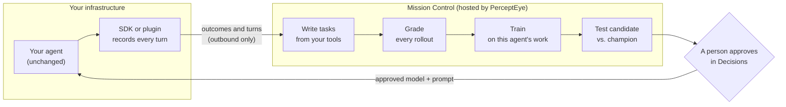

## Your agent, made better by its own work

Agent Flywheel turns the work your agent already does into training data, and hands back a better model and prompt for you to approve. Your agent keeps running in your process, behind your firewall, on your credentials. Its code does not change.

<Image src="https://raw.githubusercontent.com/percepteye-ai/agent-flywheel/main/docs/assets/flywheel-overview.gif" alt="Your agent (prompt, tools and model) sits inside your infrastructure. The SDK wraps it from the outside with zero lines changed inside. Outcomes go out, a trained policy comes back, and the model row flips from your model to one trained on this agent's own work." width="1280" height="720" />

## Ship it

Pick the line that matches where your agent runs. Each one gets you to a recording agent; the [Quickstart](/quickstart) takes it the rest of the way.

<CodeGroup tabs="Python,OpenClaw,DeepSeek Harness,OpenTelemetry">

```bash
pip install agent-flywheel
agent-flywheel login --agent-id support-agent
```

```bash
openclaw plugins install @percepteye/agent-flywheel
npx @percepteye/agent-flywheel login --agent-id support-agent
```

```bash
dsh plugin --profile <name> add @percepteye/agent-flywheel
```

```bash
export PERCEPTEYE_CONTROL_PLANE_URL=https://launch.percepteye.ai/api/flywheel/v1
export PERCEPTEYE_API_KEY=pefw_...   # from Mission Control
export OTEL_EXPORTER_OTLP_TRACES_ENDPOINT="$PERCEPTEYE_CONTROL_PLANE_URL/agents/support-agent/otlp/v1/traces"
export OTEL_EXPORTER_OTLP_TRACES_HEADERS="Authorization=Bearer%20$PERCEPTEYE_API_KEY"
export OTEL_EXPORTER_OTLP_TRACES_PROTOCOL=http/protobuf
```

</CodeGroup>

Then, in Python, one call at startup records every turn your agent serves:

```python
import agent_flywheel as fw

px = fw.attach(agent_id="support-agent", trajectory_root="/var/lib/percepteye")

with px.turn(conversation_id=conv_id, input_text=user_text) as turn_id:
    reply = agent.invoke(user_text)          # your agent, unchanged
px.record_answer(turn_id, reply)
```

<Callout kind="tip">

No key yet? Everything still works locally. Without a key the SDK records to your disk and sends nothing, so you can try it before you sign up.

</Callout>

## The loop in one picture



Every arrow that crosses into Mission Control is a request your process makes. Nothing dials in, so there is no inbound port, public DNS record or certificate to manage.

<Columns cols={3}>
  <Card title="1. Capture" icon="eye" href="/integrations">

  The SDK or plugin records what your agent did: every tool call as `ok`, `failed` or `unknown`, plus the turns you allow it to send.

  </Card>
  <Card title="2. Improve" icon="sparkles" href="/concepts">

  Mission Control writes tasks from your agent's real tools, grades every run, and trains a policy on this agent's own trajectories.

  </Card>
  <Card title="3. Approve" icon="user-check" href="/approval">

  Each candidate is tested against the model you run today. Nothing reaches your users until a person approves it.

  </Card>
</Columns>

## What it costs to integrate

| | |
| --- | --- |
| Lines changed inside your agent | **0**. Adapters bind from the outside. |
| Integration code | **1 import and 1 call** in Python, or **one plugin install** in Node |
| Runtime dependencies | **1** in Python (`httpx`), **0** in Node |
| Inbound ports, containers, GPUs | **0, 0, 0**. Training runs on PerceptEye's GPUs. |
| Languages | Python by import path, any CLI by argv, anything else through OpenTelemetry |
| License | MIT, on [GitHub](https://github.com/percepteye-ai/agent-flywheel) |

## What you get

| You get | What it means |
| --- | --- |
| An agent that improves in place | A policy trained on this agent's own trajectories: its prompt, its tools, its failure modes. Not a generic model. |
| Post-training you never operate | Task generation, grading, reinforcement learning and promotion gates run in Mission Control. |
| A prompt that improves too | Training co-optimizes the system prompt and ships the approved one back beside the model. |
| Honest evidence | A tool call nobody saw succeed is `unknown`, never rounded up to `ok`. A verifier abstains instead of learning from a guess. |
| A person in charge | No threshold, scheduler or language model can promote a change. An operator clicks approve, and rolling back is the same click. |

## Explore

<Columns cols={3}>
  <Card title="Quickstart" icon="zap" href="/quickstart">

  Install, get a key and see your first turn arrive in about five minutes.

  </Card>
  <Card title="Choose an integration" icon="signpost" href="/integrations">

  Python, OpenClaw, DeepSeek Harness, goose, any CLI or OpenTelemetry.

  </Card>
  <Card title="How the loop works" icon="refresh-cw" href="/concepts">

  Every beat of the flywheel, and who does the work at each one.

  </Card>
  <Card title="Mission Control" icon="layout-dashboard" href="/mission-control">

  The hosted half: where tasks are written, models trained and changes approved.

  </Card>
  <Card title="Security and network" icon="shield" href="/security">

  Outbound-only lanes, what is sent, and what never leaves your machine.

  </Card>
  <Card title="Python API" icon="code" href="/reference/python">

  Every argument of `serve()`, `attach()` and `policy_source()`.

  </Card>
</Columns>
