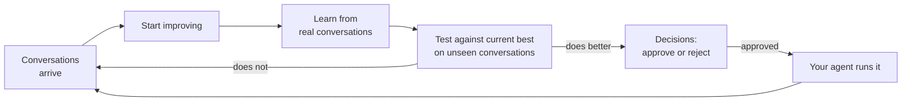

## The other half of the flywheel

Installing the SDK is half of the flywheel. The other half writes the tasks, grades every rollout and trains the model. That half is **Mission Control** at [launch.percepteye.ai](https://launch.percepteye.ai/onboard/agent-sdk). PerceptEye runs it on PerceptEye's GPUs, so there is nothing for you to deploy, scale or keep on call.

| | The SDK or plugin | Mission Control |
| --- | --- | --- |
| Runs | In your process, beside your agent | Hosted by PerceptEye |
| Does | Records every tool outcome, captures the turns you serve, runs practice tasks, picks up the approved model | Writes tasks from your agent's real tools, grades every rollout, trains the policy, measures each candidate against the model you run today |
| Shows you | One log line per lap | Every agent, what arrived from each, every candidate against the champion, and the switch that moves an agent between them |
| You bring | `pip install agent-flywheel` or the OpenClaw plugin | An email address |

**A key joins the two halves.** Without one, `serve()` stops before the first rollout and `attach()` keeps every turn on your own disk. Nothing is sent, so nothing is trained, and both say so in one line that names where to get a key.

## From sign-up to your first approval

The screens below show a sample agent.

<Steps>
<Step title="Create a workspace" icon="user-plus">

An email, a password and a six-digit code. Free plan, no credit card. `agent-flywheel login` takes you here too.

<Image src="https://raw.githubusercontent.com/percepteye-ai/agent-flywheel/main/docs/assets/control-plane-signup.png" alt="The Create your account card in Mission Control: email, password, confirm password, and a note that a six-digit code confirms the address." width="1384" height="762" />

</Step>
<Step title="Choose how to connect your agent" icon="plug">

Add the SDK to your agent's code, send the traces it already exports, connect the observability provider your traces go to, or upload a trace file.

<Image src="https://raw.githubusercontent.com/percepteye-ai/agent-flywheel/main/docs/assets/control-plane-choose.png" alt="Mission Control's choice of four ways to connect an agent: add our SDK, send the traces it already exports, connect where your traces live, or upload a trace file." width="1384" height="762" />

</Step>
<Step title="Add the SDK and get the key" icon="key">

Name the agent and copy its `pefw_` key. It is shown once and scoped to that one agent. The status panel turns to **Connected** on your agent's first call, then asks for permission.

<Image src="https://raw.githubusercontent.com/percepteye-ai/agent-flywheel/main/docs/assets/control-plane-sdk.png" alt="The Add our SDK to your agent's code screen for a sample agent named support-agent: Python and Node (OpenClaw) tabs with install, record and environment steps, beside a status panel reading Agent created and Connected." width="1384" height="942" />

</Step>
<Step title="Watch, then approve" icon="user-check">

Every candidate is measured against the model your agent runs today. Nothing moves until a person clicks **Try the candidate**, and **Move back to champion** undoes it.

<Image src="https://raw.githubusercontent.com/percepteye-ai/agent-flywheel/main/docs/assets/control-plane-agent.png" alt="A sample agent's page: it runs the champion, with a Try the candidate button and a candidate-versus-base table showing improved verdicts with mean-reward and pass-rate gains." width="1384" height="762" />

</Step>
</Steps>

## Where everything is

Every click path in these docs, in one place. Sign in at [launch.percepteye.ai](https://launch.percepteye.ai).

| To | Go to |
| --- | --- |
| Get a key for the SDK | **New mission** → **Your AI agent** → **Add our SDK to your agent's code** → name the agent → **Create agent and get my key** |
| Send OpenTelemetry traces | **New mission** → **Your AI agent** → **Also send us the traces your agent already exports** → name the agent → **Create agent and get my key** |
| Read traces from your observability provider | **New mission** → **Your AI agent** → **Connect your observability provider** |
| Upload a trace file | **New mission** → **Your AI agent** → **Upload a trace file** |
| Replace a lost key | **Agents** → your agent → **Get a new key** |
| Revoke a key | **Settings** → **Agent keys** → **Revoke** |
| See what arrived | Your agent's page → **Agent** tab → **What it has sent us to learn from** |
| Start an improvement round | **Start improving**, at the end of setup or on your agent's page |
| Run practice tasks | Your agent's page → **Advanced** → **Generate tasks and run them**, or **Generate, run and improve** |
| Approve a winner | **Decisions**, in the sidebar |
| Try a new version on one agent | Your agent's page → **Agent** tab → **Try the candidate** |
| Undo that | **Move back to champion** |
| Choose what we keep | **Settings** → **Rollout retention** |

<Callout kind="info">

Only an organization admin can create an agent and its key, change an agent's permissions, or change retention. A key expires after 180 days. A new key is shown once, and the old one keeps working until it expires or you revoke it.

</Callout>

## Permissions

During setup, one checkbox, **Let us learn from its conversations, including the message text**, switches on both of the agent's permissions. Its page shows them separately:

| Permission | What it covers |
| --- | --- |
| **Send us its conversations** | Each turn's steps: the user's message, the tool calls and their outcomes, and your agent's answer |
| **Include the message text** | What the model saw and said: the system prompt, the conversation so far, the tool definitions and every tool result |

Learning needs both. Switch either off at any time on the agent's page; your agent notices without a restart, and turns stay on your disk until they are on again. Details are on [Production capture](/production).

## Improvement rounds

**Start improving** needs the permission on. If the round is paid from your credits, it shows the most it can cost before it starts. Run it again whenever new conversations have arrived; each round starts from the best so far. If there is not yet enough to learn from, it says so.

## Next

<Columns cols={2}>
  <Card title="Human approval" icon="user-check" href="/approval">

  The gates every candidate must pass, and why each fails closed.

  </Card>
  <Card title="Authentication" icon="key-round" href="/authentication">

  Agent keys, terminal login, rotation and revocation.

  </Card>
</Columns>
