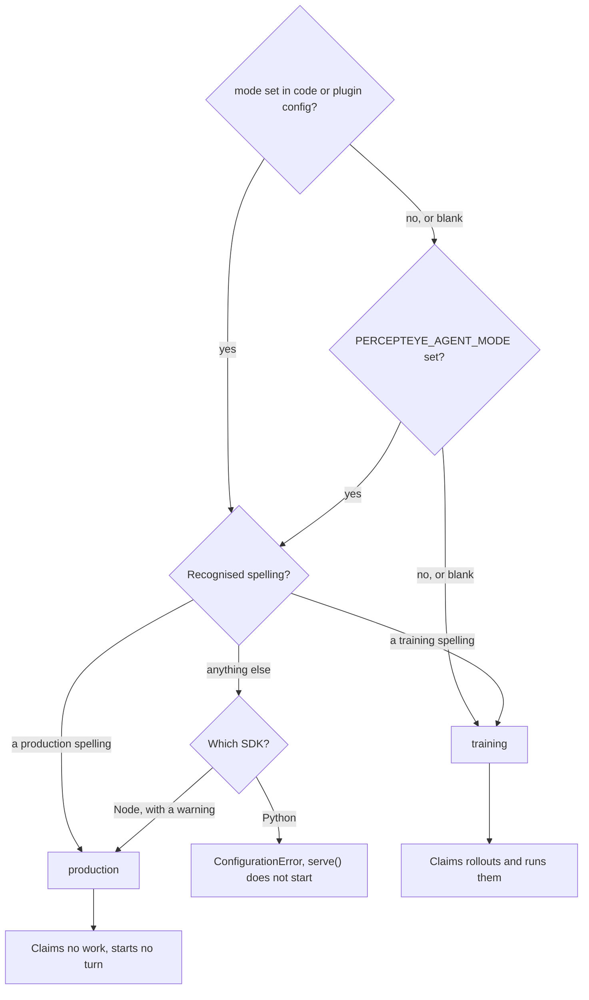

One environment variable decides whether a deployment does training work or only serves your users. This page covers what each mode does in the Python SDK and the Node plugin, which spellings are accepted, and what happens when the value is wrong.

```bash
PERCEPTEYE_AGENT_MODE=training      # the default when unset: claim rollouts and run them
PERCEPTEYE_AGENT_MODE=production    # the deployment serving your users
```

## One image, two jobs

The same container does either, with no code edit. "Stop contributing capacity" is an operational decision, and it should not require editing source to express it.

| | `training` | `production` |
|:--|:--|:--|
| pick it for | a machine you are happy to lend to rollouts | the deployment serving your users |
| claims rollouts | yes | no |
| runs your agent on practice tasks | yes | no |



## In the Python SDK

The switch gates `serve()`, the call that does training work, and nothing else.

| | `training` | `production` |
|:--|:--|:--|
| `fw.serve(...)` | claims and runs rollouts | returns `0` immediately, before opening any connection |
| needs a key | yes (the URL has a default) | no |
| `fw.attach(...)` | not gated | not gated |

What `production` does, precisely:

| behavior | why |
|:--|:--|
| returns `0` before opening any connection | a production deployment needs no control-plane URL and no key; turning training off must never require being configured for it |
| returns rather than raises | a switch that crashes the service it was meant to quiet is not a switch |
| prints exactly one line | a silent no-op would leave an operator believing capacity was being contributed |
| resolved before the entrypoint is imported | `serve("does_not_exist:build", ...)` under `production` still returns `0`: nothing is loaded, validated or dialed |

The line, verbatim:

```text
[percepteye] mode=production — not claiming rollouts. (set PERCEPTEYE_AGENT_MODE=training to contribute capacity)
```

<Callout kind="info">

`attach()` is not gated. It is the production surface, and gating it on the same variable would make `training` the correct setting for a production agent. To stop capture, do not call `attach()`, or pass `register=False` to keep it entirely on your disk. See [Production capture](/production).

</Callout>

A production process that contributes nothing still picks up the trained model. No `serve()`, no `attach()`, no registration:

```python
kw = fw.apply_current_policy(agent_id="support-agent")
if kw:                                   # {} means keep your current config
    client = OpenAI(base_url=kw["base_url"], api_key=kw["api_key"])
    model = kw["model"]
```

What reaches that call, and who approves it, is on [Human approval](/approval).

## In the Node plugin

Everything the plugin does beyond local recording is decided by `PERCEPTEYE_AGENT_MODE`, or the `mode` key in its OpenClaw config.

| | `training` (default) | `production` |
|:--|:--|:--|
| Records tool outcomes locally | yes | yes |
| Alters a tool result | **never** | **never** |
| Claims rollouts | yes | **no** |
| Puts a task into your agent's context | yes | **no** |
| Starts turns by itself | yes | **no** |
| Captures the turns you serve | n/a | yes |
| Uploads them | n/a | only once the agent's [permission](/production) is on |
| **Applies your approved system prompt** | **no** | **yes**, off with `PERCEPTEYE_APPLY_PROMPT=0` |
| **Points your agent at the approved model** | **no** | **yes**, with `hooks.allowConversationAccess: true`; off with `PERCEPTEYE_APPLY_MODEL=0` |

**Production claims no work and starts no turn.** The rollout hooks are not registered at all, so the guarantee is the absence of a subscription rather than a branch inside a handler. Production is not observe-only, though: applying the approved prompt and model changes what your agent does, and that is the last step of the loop.

**Production applies the approved pair to this agent's own served turns and nothing else.** Not to a subagent it spawns, not to a scheduled (cron) turn, and not to another agent in the same gateway. If the plugin cannot tell which agent a run belongs to, it applies nothing. Set `agentId` when your gateway runs more than one agent.

**Training never applies either half, deliberately.** A rollout is evidence about the agent as configured. Changing its prompt or its model mid-flight would move its behavior with no weight change behind it, and the loop would attribute the difference to training.

**In training the plugin works the flywheel on its own,** starting each rollout's turn in its own `percepteye-rollout-*` session, never one you are using. It refuses to claim work without `hooks.allowConversationAccess: true`, and says so once at startup.

On DeepSeek Harness the plugin records outcomes and nothing else, in every mode.

Three more switches, each an environment variable or a config key (`capture`, `applyPrompt`, `applyModel`), where config wins:

```bash
export PERCEPTEYE_CAPTURE=0        # register nothing, record nothing, claim nothing
export PERCEPTEYE_APPLY_PROMPT=0   # keep recording, but leave the system prompt alone
export PERCEPTEYE_APPLY_MODEL=0    # keep recording, but leave the model alone
```

## Accepted spellings

Case-insensitive, surrounding whitespace stripped. Both SDKs use the same closed set, so `PERCEPTEYE_AGENT_MODE=prod` means the same thing in either.

| value | resolves to |
|:--|:--|
| `training`, `train`, `rollout`, `rollouts`, `fine-tuning`, `finetuning`, `improving` | **training**: contribute capacity |
| `production`, `prod`, `serving` | **production**: do not |

`rollout` is the legacy spelling of `training` and unchanged in meaning. On the wire, a training process still registers `mode: "rollout"`, which names the protocol it speaks.

## Precedence

| rank | source | note |
|:--|:--|:--|
| 1 | `mode=` on `serve()` (Python), or `mode` in the plugin config (Node) | an empty or whitespace-only value counts as not set and falls through |
| 2 | `PERCEPTEYE_AGENT_MODE` | lets an operator flip a deployment without editing code |
| 3 | `training` | the default when neither is set |

The empty-string rule matters. `mode=cfg.get("percepteye_mode", "")` is the ordinary way a config layer says "not set". Honoring it as a value would pin the process to `training` without ever reading the variable, so an operator who flipped the switch would keep contributing.

In Python, an override is announced in both directions. When `mode=` in code disagrees with the environment, the line says which won:

```text
[percepteye] mode=training — set by mode= in code, overriding PERCEPTEYE_AGENT_MODE=production.
Remove mode= from the call to let this deployment decide.
```

An unparseable environment value alongside a valid `mode=` is a `RuntimeWarning`, not fatal: the argument is authoritative, but an unreadable switch is not passed over in silence.

## An unrecognised value

Both ways of guessing wrong are invisible from outside: contributing capacity the operator switched off, or contributing nothing while they believe training runs. So neither SDK guesses `training`.

<Tabs>
<Tab title="Python" icon="code">

`serve()` raises `ConfigurationError` before doing anything else:

```text
ConfigurationError: PERCEPTEYE_AGENT_MODE='staging' is not a mode. Use 'training'
(this process does training work: it claims rollouts and runs them) or 'production'
(it does not). Recognised spellings: fine-tuning, finetuning, improving, prod,
production, rollout, rollouts, serving, train, training.
```

`serve()` is a process entry point, so refusing to start is the whole remedy. `fw.current_mode()` (environment only) and `fw.resolve_mode(explicit)` raise the same way, so a typo surfaces wherever it is first read.

</Tab>
<Tab title="Node" icon="package">

The plugin degrades to `production` and logs a warning that names the bad value, the accepted spellings, and this:

```text
Running in production mode until this is corrected; no rollouts will be claimed.
```

Throwing would fail the plugin load and take local capture down with it, over a typo in a setting capture does not depend on. Production is the safe side of a mode it could not read: the worst case is that the install does less than intended, and says so. The warning also reminds you that production still captures served turns and applies the approved system prompt.

The degrade applies to the environment variable. The plugin's config schema accepts only the spellings above for the `mode` key, so OpenClaw's own config validation refuses a typo there before the plugin runs.

</Tab>
</Tabs>

## When the switch is read

In Python the mode is read once, when `serve()` starts. Flipping the variable does not stop a flywheel that is already claiming; `max_rollouts=N` is the only clean exit. See [Configuration](/configuration) for how to stop a running flywheel, and [Production capture](/production) for what a production process records.
