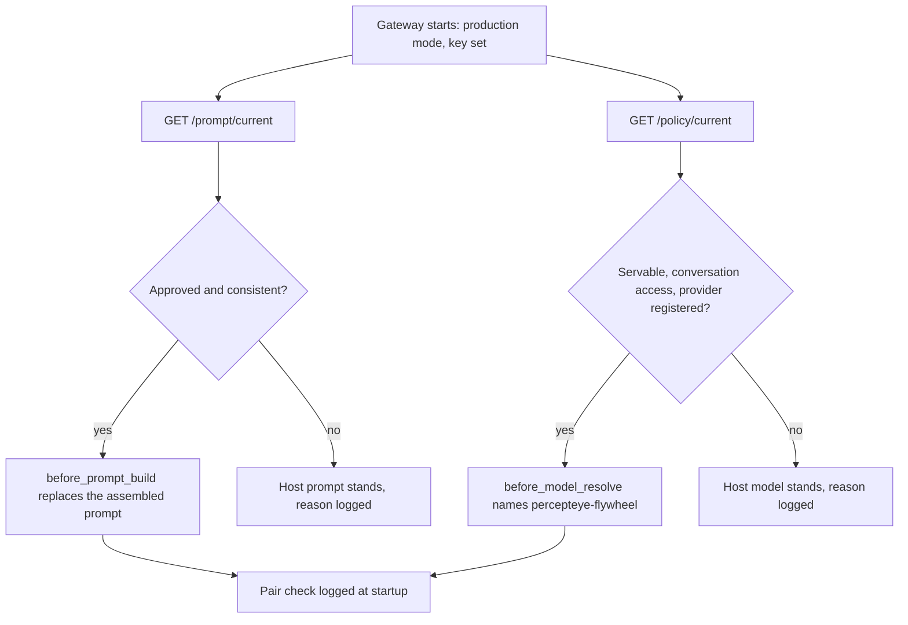

`@percepteye/agent-flywheel` is a plugin your harness loads beside your agent: it records what every tool call actually did, and on OpenClaw it also works practice tasks, captures the turns you serve and applies the prompt and model a person approved. No import, no wrapper process, no sidecar.

Version 0.3.0. Node `>=22.22.3`. Zero runtime dependencies. It registers with the host as `agent-flywheel`.

## What it does in each harness

| harness | records outcomes | practice tasks | production turn capture | applies the approved prompt | applies the approved model |
|:--|:--|:--|:--|:--|:--|
| **OpenClaw** | yes, `after_tool_call` | yes, training mode | yes | yes, `before_prompt_build` | yes, `before_model_resolve` plus a registered provider (needs `allowConversationAccess`) |
| **DeepSeek Harness** | yes, `tools/result` | no | no | no | no |

DeepSeek Harness exposes no seam for handing a task to a running agent, so there the plugin records tool outcomes and nothing else, in every mode.

## Install

<Tabs>
<Tab title="OpenClaw" icon="package">

<Steps>
<Step title="Install the plugin" icon="download">

```bash
openclaw plugins install @percepteye/agent-flywheel
```

</Step>
<Step title="Get the agent's key" icon="key">

```bash
npx @percepteye/agent-flywheel login --agent-id support-agent
```

It prints a short code and opens launch.percepteye.ai with the code filled in. Click **Approve**, and the key is stored in `~/.percepteye/credentials.json` (or `$PERCEPTEYE_HOME/credentials.json`), readable only by you. The Python SDK's `agent-flywheel login` writes the same file, so either serves both. Or set the key where your gateway starts, since it reads its environment once at launch:

```bash
export PERCEPTEYE_API_KEY=pefw_...
```

Without a key nothing leaves the machine. Local recording of your agent's real tool-failure rate still works, with no account.

</Step>
<Step title="Configure the plugin in OpenClaw" icon="settings">

```jsonc
// your OpenClaw config
{ "plugins": { "entries": { "agent-flywheel": {
    "hooks": { "allowConversationAccess": true },
    "config": { "agentId": "support-agent", "mode": "production" } } } } }
```

`allowConversationAccess` does three jobs, and each is dropped without it. It lets the plugin read your agent's answer (`agent_end`), describe your agent (`llm_input`), and point your agent at the approved model (`before_model_resolve`). OpenClaw classes all three as conversation hooks and drops them for non-bundled plugins unless you opt in. The plugin **refuses to claim work without it** rather than half-working, and says so once at startup. Applying the approved prompt is the one thing that does not need it.

`agentId` is the name you gave the agent in Mission Control, and it decides whose approved prompt and model this install applies (default `openclaw`). `mode` is `production` for the process serving your users, or `training` (the default) to work practice tasks. Config wins over the environment.

</Step>
<Step title="Restart OpenClaw" icon="play">

The startup log says what state the install is in:

```text
[agent-flywheel] production capture is ENABLED for 'support-agent'; turns upload every 32 turns and at shutdown.
```

Or `capturing locally; turns will NOT be uploaded:` followed by why. Give the agent [permission](/mission-control) in Mission Control and uploads start without another restart.

</Step>
</Steps>

</Tab>
<Tab title="DeepSeek Harness" icon="terminal">

<Steps>
<Step title="Add the plugin to a profile" icon="download">

```bash
dsh plugin --profile <name> add @percepteye/agent-flywheel
```

</Step>
<Step title="Give it a trajectory directory" icon="database">

The plugin records `tools/result` outcomes only, appending to `$PERCEPTEYE_TRAJECTORY_DIR/tool_calls.jsonl`. With that variable unset it writes nothing. Python's `serve()` sets it for each practice task when it runs dsh as a command:

```python
fw.serve(["dsh", "--profile", "headless", fw.TASK], agent_id="support-agent",
         input_shape="text", endpoint_env=("DEEPSEEK_BASE_URL", "DEEPSEEK_API_KEY"))
```

See [CLI agents](/cli-agents) for how a command is served.

</Step>
<Step title="Run dsh as usual" icon="play">

Nothing else is registered: no control-plane call, no prompt or model change, no turn capture.

</Step>
</Steps>

</Tab>
</Tabs>

## The approved pair, applied in production

Training improves the model and the system prompt together, and a person approves each before it ships ([Human approval](/approval)). With a key, a `production` install asks once at startup what this agent should run, and applies both halves:

- **The prompt.** `GET /prompt/current`; the approved text replaces the prompt your host assembled, through `before_prompt_build`.
- **The model.** `GET /policy/current`; the plugin registers a provider, `percepteye-flywheel`, names it from `before_model_resolve`, and supplies the served `base_url` through that provider's transport. The provider answers for its own id and nothing else, so your other providers' traffic is untouched.



**Read once, at startup.** A policy that moved under a running agent would split its traffic across two behaviours. Restart to pick up a new version; `serving_generation` in the startup line changes when and only when the answer does.

**This agent's own turns only.** Neither half applies to a subagent it spawns, a scheduled (cron) turn, or another agent in the same gateway. On a gateway running several agents with no `agentId` set, the plugin applies nothing and says so.

**The pair check is the line worth reading.** When both halves land:

```text
the pair is intact: the approved prompt is running on the checkpoint it was certified with (stamped …), which is the combination that was evaluated
```

When only one lands, it warns with `HALF THE PAIR:` and names which half is missing and why, because half of a certified combination is not the improvement that was measured.

| what stops the prompt | why |
|:--|:--|
| no API key | the control plane is never asked and no hook is subscribed |
| `PERCEPTEYE_APPLY_PROMPT=0` | the hook is not subscribed and the prompt text is not fetched |
| an empty answer | nothing has passed approval; your prompt stands |
| `stale_baseline` | your baseline prompt changed after the pair was certified |
| a status other than `approved` / `delivered` | a draft or pending bundle never serves |
| the bundle disagrees with itself | its prompt checksum and its checkpoint differ |

| what stops the model | why |
|:--|:--|
| no API key | as above |
| `PERCEPTEYE_APPLY_MODEL=0` | you switched it off |
| no `allowConversationAccess` | the host never delivers `before_model_resolve` |
| no provider could be registered | the provider is the only way to supply the served `base_url` |
| the model was withdrawn (`withdrawn: true`) | your host's model stands from the next start |
| no endpoint served | the agent is on the champion, or its candidate is not deployed |
| a `gs://` or `s3://` reference as the model | a stored artifact, not something an endpoint can serve |

An unreachable control plane costs the improvement and nothing else. If the served endpoint needs a credential, it comes from your own `models.providers.percepteye-flywheel.apiKey`; the plugin's `PERCEPTEYE_API_KEY` is sent only to an endpoint at the control plane's own address.

## Three kill switches

```bash
export PERCEPTEYE_CAPTURE=0        # register nothing, record nothing, claim nothing
export PERCEPTEYE_APPLY_PROMPT=0   # keep recording, leave the system prompt alone
export PERCEPTEYE_APPLY_MODEL=0    # keep recording, leave the model alone
```

Each is also a config setting (`capture`, `applyPrompt`, `applyModel`), and config wins. In every case the guarantee is the absence of the subscription, not a branch inside a handler. Your host can also block the halves from outside: `hooks.allowPromptInjection: false` stops the prompt, and leaving `allowConversationAccess` unset stops the model.

`PERCEPTEYE_TRAJECTORY_DIR` is not an off switch. It names where a training rollout's outcomes are written.

## It never alters a tool result

Every recording hook is structurally unable to change a run. OpenClaw's `after_tool_call` returns `void`; dsh's `tools/result` is `@mode emit` over deep-frozen objects. The mutation seams both harnesses offer (result middleware, `tools/post`) are unused in every mode.

The hooks that do change behaviour are separate subscriptions: in production, `before_prompt_build` and `before_model_resolve` apply the approved pair. In training, `before_agent_run` and `before_tool_call` block a queued turn or a later tool call once its rollout's lease has lapsed. In training the plugin starts each practice task in its own `percepteye-rollout-*` session (if the host closes that seam, it says so and delivers the task into the next turn you start), and applies neither half, because a rollout is evidence about the agent as configured.

## Tell it what it cannot see: `describe` and `rules`

OpenClaw's `llm_input` carries no tool list, so on its own the plugin registers an agent whose tools are unknown, and **no task can be generated for it**. Declare them:

```json
"plugins": { "entries": { "agent-flywheel": { "config": { "describe": {
  "system_prompt": "You triage support tickets.",
  "tools": [{ "name": "lookup_ticket", "description": "Read one ticket.",
              "input_schema": { "type": "object", "properties": { "id": { "type": "string" } } },
              "read_only": true }]
} } } } }
```

It is the Python SDK's `describe=`, read by the same rules. `tools` takes OpenAI function specs, Anthropic tools, or `{name, description, input_schema, read_only}`. What you declare wins over what was observed. A bad declaration does not stop the plugin: it is dropped with a warning naming the cause.

`rules` are your Product's workflow rules, one prose string each. They become the rulebook of the Product that declares this agent and are used as training guidance; they are never added to your served agent's prompt.

```json
"plugins": { "entries": { "agent-flywheel": { "config": { "rules": [
  "Before issuing a refund, confirm the order number with the customer.",
  "Escalate to a human when the customer asks to close their account."
] } } } }
```

Unset sends nothing, `[]` retracts, and the last writer wins. Every setting is in the [Node plugin settings](/reference/node).

## What it writes

One JSON object per executed tool call, appended to `tool_calls.jsonl`. This line is real output from a live OpenClaw run, in the same format the Python SDK writes and reads:

```json
{"name":"exec","arguments":{"command":"exit 3"},"outcome":"failed","status_code":null,"error":"(Command exited with code 3)","error_class":"ToolError","latency_ms":155,"agent_name":"main","tool_call_id":"call_percepteye_1"}
```

In `production`, each served turn is its own directory:

```text
$PERCEPTEYE_CAPTURE_DIR/<runId>/       # default ~/.percepteye/captured
    turns.jsonl        {"kind":"task"|"answer","text","turn_id","conversation_id","task_id"}
    conversation_id
    task_id            # optional caller-authored correlation
    tool_calls.jsonl
    genai_observation.jsonl   # only under the model-content tier
```

Uploading is off until an org admin gives the agent permission. Once on, turns go every 32 turns and again at gateway shutdown, and the files stay on your disk; `retentionTurns` in the plugin config bounds how many. What the model saw is recorded only when message text is allowed too, and needs `allowConversationAccess`. See [Production capture](/production).

<ExpandableGroup>
<Expandable title="The training outbox and its .refused-* files" default-open="false">

In training mode, each rollout result the control plane has not acknowledged sits under `$PERCEPTEYE_HOME/outbox/<agentId>/`. It is written before the report is sent and removed the moment it lands, and held results are delivered before the next rollout is claimed, including by a later process over the same directory.

- **A file still present is work the control plane has not recorded yet.** It is retried in front of every claim.
- **A refusal resending cannot fix stops the retries and never deletes the file.** It is renamed: `.refused-lease-lost` when the lease is gone (what a 410 becomes), `.refused-contract` when this SDK could not carry the payload, `.refused-400`, `.refused-404`, `.refused-409` or `.refused-422` for the remaining final statuses, and `.stale` for a file that aged out after seven days. A second refusal of the same rollout gets `.refused-lease-lost.1` rather than overwriting the first.
- **An unrecognised status keeps retrying**, and so do `401` and `403`: a reissued key delivers them.
- **No rollout credential is ever written there.** The lease token stays in memory.

</Expandable>
</ExpandableGroup>

## Python or Node?

Pick one, matching the harness your agent already runs in. Never install both for the same agent.

| | Node plugin | [Python SDK](/python-sdk) |
|:--|:--|:--|
| you have | an OpenClaw or DeepSeek Harness agent | a Python agent, or a CLI agent you launch yourself |
| you install | a harness plugin | `pip install agent-flywheel` |
| you change | nothing: the harness loads it | nothing: one import, one call |
| the approved prompt | applied for you through the host's prompt seam | handed back by `current_prompt()` for you to apply |
| the approved model | applied for you through a registered provider | handed back as an endpoint for you to call |

## Next

<Columns cols={3}>
  <Card title="Node plugin settings" icon="package" href="/reference/node">

  Every config key and environment variable.

  </Card>
  <Card title="Production capture" icon="activity" href="/production">

  What is sent and when, retries, personal data.

  </Card>
  <Card title="Mission Control" icon="layout-dashboard" href="/mission-control">

  Permissions, approvals and rollback.

  </Card>
</Columns>
