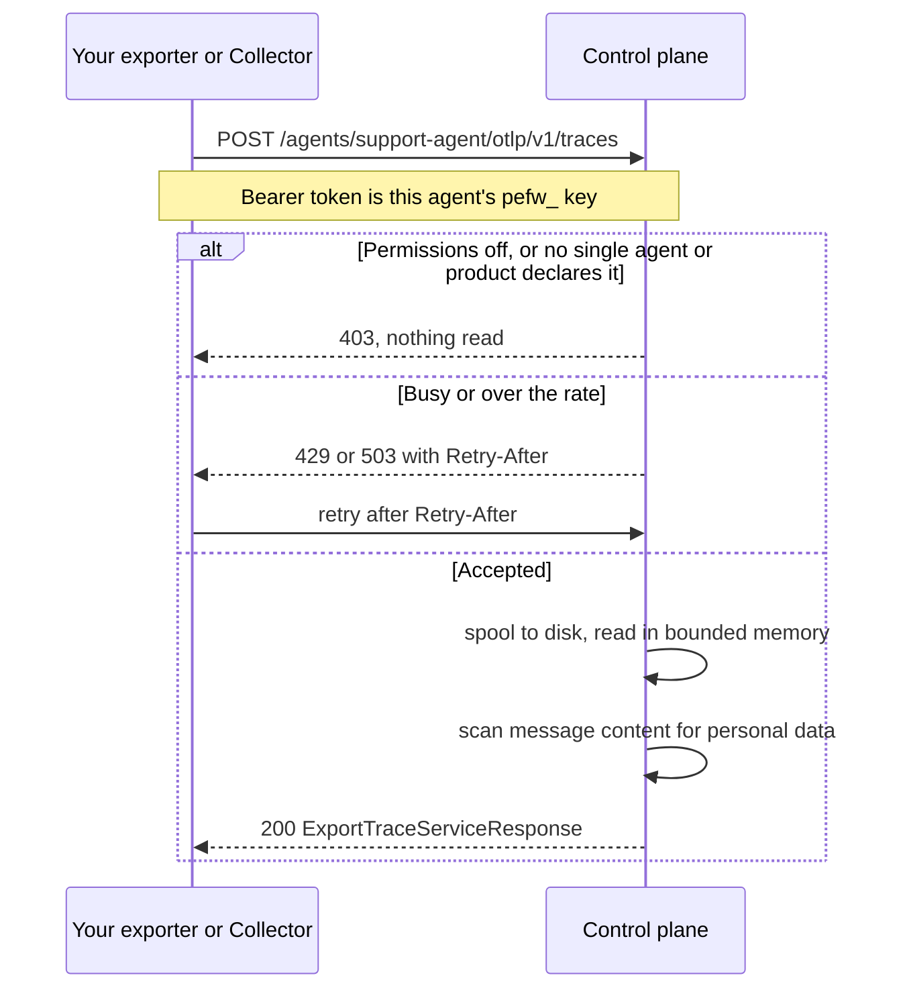

If your agent already records its model calls as OpenTelemetry spans, in the [GenAI semantic conventions](https://opentelemetry.io/docs/specs/semconv/gen-ai/) and with message content, point its exporter or your Collector at the control plane. Its production conversations then drive the improvement loop, with no SDK installed.

```text
POST $PERCEPTEYE_CONTROL_PLANE_URL/agents/<agent_id>/otlp/v1/traces
```

## Push, or install the SDK?

| | push spans | the SDK ([Python](/python-sdk) or [Node](/node-plugin)) |
|:--|:--|:--|
| pick it when | the agent is already instrumented with OpenTelemetry, or runs where the SDK cannot be installed | you also want practice tasks, written for your agent and graded |
| learns from | the conversations your spans record | the turns the SDK uploads, plus graded practice tasks |
| practice tasks | no: spans only carry what your agent already did | yes |
| what you change | exporter or Collector configuration | one install and one call, or a harness plugin |

<Callout kind="alert">

**Send each conversation one way only.** Pushed spans and turns uploaded by the SDK are both kept, so the same traffic sent both ways is learned from twice.

</Callout>

If your traces already go to an observability provider, Mission Control can also read them from there with nothing changed in your agent: **New mission** → **Your AI agent** → **Connect your observability provider**.

## Set it up

<Steps>
<Step title="Add the agent in Mission Control" icon="plus">

**New mission**, in the sidebar → **Your AI agent** → **Also send us the traces your agent already exports** → name the agent → **Create agent and get my key**.

That names the agent, gives it its `pefw_` key and registers it. The key is shown once, at the top. Below it, choose **I run an OpenTelemetry Collector** or **My agent exports directly**, and copy what it shows, the agent's endpoint included. Only an organization admin can create an agent and its key, and a key expires after 180 days.

</Step>
<Step title="Point the exporter" icon="radio-tower">

We are one more place your traces go. With a Collector, add us as one more exporter and your current destination keeps receiving everything. Without one, the exporter variables *move* the agent's traces to us, because an exporter has one destination.

<CodeGroup tabs="Exporter env vars,Collector">

```bash
export OTEL_EXPORTER_OTLP_TRACES_ENDPOINT="$PERCEPTEYE_CONTROL_PLANE_URL/agents/support-agent/otlp/v1/traces"
export OTEL_EXPORTER_OTLP_TRACES_HEADERS="Authorization=Bearer%20$PERCEPTEYE_API_KEY"
export OTEL_EXPORTER_OTLP_TRACES_PROTOCOL=http/protobuf
```

```yaml
exporters:
  otlphttp/percepteye:
    traces_endpoint: ${env:PERCEPTEYE_CONTROL_PLANE_URL}/agents/support-agent/otlp/v1/traces
    headers:
      Authorization: "Bearer ${env:PERCEPTEYE_API_KEY}"

service:
  pipelines:
    traces:
      receivers: [otlp]                                     # as you have them
      processors: [batch]                                   # as you have them
      exporters: [otlp/your-backend, otlphttp/percepteye]   # yours, and ours
```

</CodeGroup>

`%20` is the space: OpenTelemetry reads these headers URL-encoded. If the process exports only traces, `OTEL_EXPORTER_OTLP_ENDPOINT` set to the same URL without `/v1/traces` works too; the exporter appends it. In a Collector, set `PERCEPTEYE_CONTROL_PLANE_URL` and `PERCEPTEYE_API_KEY` in its environment and keep your own exporter in the list, since a pipeline sends only to the exporters it names. The endpoint and key belong to one agent, so each agent needs its own exporter.

</Step>
<Step title="Turn on both permissions" icon="lock">

During setup, one checkbox: **Let us learn from its conversations, including the message text**. It switches on the agent's two permissions, which its page shows separately: **Send us its conversations** and **Include the message text**.

Until both are on, every push is answered `403` and nothing in it is read. You can switch them off on the agent's page at any time; only an organization admin can change them.

</Step>
<Step title="Check your spans carry message content" icon="eye">

Many instrumentations record message content only when you switch it on. Without it a push succeeds, but there is nothing to learn from, and the agent's page counts nothing learnable. Turn it on in your instrumentation.

</Step>
</Steps>

## What a push looks like



## The endpoint

```text
POST $PERCEPTEYE_CONTROL_PLANE_URL/agents/<agent_id>/otlp/v1/traces
Authorization: Bearer pefw_...
```

`PERCEPTEYE_CONTROL_PLANE_URL` is the URL Mission Control shows when you add the agent (the default is `https://launch.percepteye.ai/api/flywheel/v1`). Auth is the agent's own key as a Bearer token; a key made for another agent is refused. A request is an OTLP `ExportTraceServiceRequest`, as `application/x-protobuf` or `application/json`, optionally with `Content-Encoding: gzip`.

| status | when | retried? |
|:--|:--|:--|
| `200` | an `ExportTraceServiceResponse` in the same content type; its `partial_success` counts the spans not kept and says why | done |
| `429` | your organization is over 600 requests a minute, or already has a request being read; carries `Retry-After` | yes, by the OpenTelemetry exporters and the Collector |
| `503` | the control plane is busy; carries `Retry-After` | yes |
| `408` | the request body arrived too slowly | no: OTLP exporters do not retry it, so that batch is lost |
| `507` | the control plane is short of disk space, answered with a `google.rpc.Status` | no: that batch is lost |
| `400` | the body is not an OTLP trace export | never helps |
| `403` | a permission is off, or the agent is not declared by exactly one agent or product | never helps until you fix the cause |
| `415` | a content type or `Content-Encoding` it does not read | never helps |

**There is no size cap.** Each request is spooled to disk as it arrives and read in bounded memory. Batches, as the OpenTelemetry SDK's batch processor and the Collector send by default, are learned from soonest.

<Callout kind="tip">

A Collector that sends several requests at once gets `429` for each one past the first while it is read, and retries a second later. `sending_queue: num_consumers: 1` on the PerceptEye exporter avoids that.

</Callout>

## What is kept

- **Personal data is kept, and never learned from.** The message content of every span is scanned for email addresses, phone numbers, card numbers, US social security numbers and IP addresses. A request whose spans hold any is kept, marked and excluded from learning, and `partial_success` says so, with no span rejected. Turns the SDK uploads follow the same rule; see [Production capture](/production).
- **Practice tasks do not come this way.** Spans that carry the SDK's rollout marker, `percepteye.rollout.id`, are not kept and are counted as rejected. Rollouts reach the control plane through the SDK.
- **One owner per agent.** The agent must belong to exactly one agent or product in Mission Control. One added there does. A push for an agent that two declare, or none, is refused with `403`.

## Register without Mission Control

The push endpoint never registers an agent itself; Mission Control's setup does it for you. For an agent that never runs the SDK, register it once through the API so that its permissions can be switched on:

```bash
curl -X POST "$PERCEPTEYE_CONTROL_PLANE_URL/agents" \
  -H "Authorization: Bearer $PERCEPTEYE_API_KEY" \
  -H "Content-Type: application/json" \
  -d '{"agent_id": "support-agent", "mode": "production", "discovered_agent": null}'
```

`"discovered_agent": null` records that the agent describes nothing about itself, rather than that you switched that description off.

## See it arrive

Open the agent's page, its **Agent** tab. **What it has sent us to learn from** counts the spans it has pushed beside the turns the SDK sent, and how many of each are kept but not learned from, and why. The status panel in setup also shows when the first traces arrive. Then click **Start improving**; see [Mission Control](/mission-control).

## When pushes are refused

<ExpandableGroup>
<Expandable title="403 production_capture_not_enabled or 403 model_content_capture_not_enabled" default-open="false">

Give the agent permission in Mission Control. Both parts must be on, and the rest of the message says which is off.

</Expandable>
<Expandable title="415" default-open="false">

Send `application/x-protobuf` or `application/json`, with gzip or no compression.

</Expandable>
<Expandable title="400" default-open="false">

The body is not an OTLP trace export. A trace file belongs in an upload (**New mission** → **Your AI agent** → **Upload a trace file**), not a push.

</Expandable>
<Expandable title="Pushes succeed, but nothing is learnable" default-open="false">

The spans carry no message content. Switch it on in your instrumentation.

</Expandable>
</ExpandableGroup>

More in [Troubleshooting](/help-center/troubleshooting).
