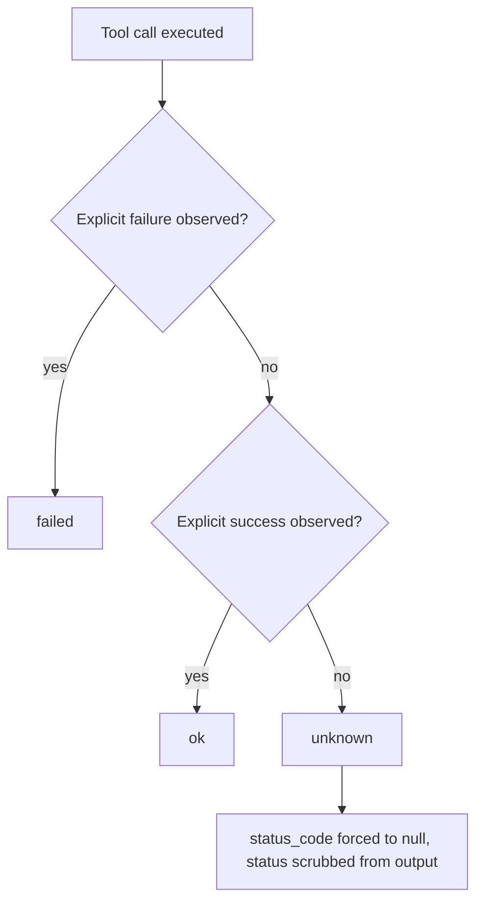

Every tool call your agent makes is recorded with one of three outcomes: `ok`, `failed` or `unknown`. This page covers what each one asserts, how to record ground truth yourself, and where outcomes come from when you write nothing.

```python
from agent_flywheel import record_tool_call

record_tool_call("charge_card", {"amount": 4200}, outcome="ok", status_code=201)
```

## Why there is a third value

Rewards are usually computed from transcripts, and transcripts lie about tool outcomes. Two shapes cause most of it:

- **A tool that swallows its own exception.** A LangChain tool with `handle_tool_error=True` catches the raise and returns a string that reads like a normal result. Nothing in the transcript separates it from a success.
- **A permission denial your API returns as HTTP 200.** The body explains the refusal; the status says fine.

Score either one as a success and the model learns the failure was fine. So when nothing observed a verdict, the SDK says `unknown`, and `unknown` is never rounded up to `ok`: not at capture, not in the trajectory, not on the wire.



The observer is whoever saw the call: your own `record_tool_call`, an adapter, or a host hook. None of them guesses.

## The three values

| value | what it asserts | `status_code` | on the wire, server-side |
|:--|:--|:--|:--|
| `ok` | an observed success | an int, or `null` | `true` |
| `failed` | an observed failure | an int, or `null` | `false` |
| `unknown` | nothing observed a verdict | forced to `null` | `null`: outcome-dependent verifiers abstain |

There is no fourth value. Anything else raises `ContractViolation`, with a message that names the alternative:

```text
ToolCallOutcome.outcome must be one of ('ok', 'failed', 'unknown'), got 'probably'.
There is no default: report what you observed, or report 'unknown'.
```

**A status is not an outcome.** `status_code` is meaningful only when you actually observed one on the wire, so every capture path in the SDK passes `status_code=None`, including for `ok`. A status may confirm or contradict an observed outcome. It may never manufacture one.

## Both fields are required, and neither has a default

`outcome` and `status_code` are keyword-only and required on `record_tool_call`, and non-defaultable on `ToolCallOutcome`. You cannot record half an outcome by forgetting a keyword:

```python
>>> ToolCallOutcome(name="POST /issue", arguments={}, outcome="ok")
TypeError: ToolCallOutcome.__init__() missing 1 required positional argument: 'status_code'
```

The permission-denial case, stated plainly. Both halves are true, so both are recorded:

```python
record_tool_call("charge_card", {"amount": 4200},
                 outcome="failed", status_code=200, error="app_auth_error")
```

```json
{"name": "charge_card", "arguments": {"amount": 4200},
 "outcome": "failed", "status_code": 200, "error": "app_auth_error"}
```

## unknown discards status from the field and the body

Withholding `status_code` alone is not enough. A scorer that parses the result body would find a status there and read an unobserved call as a landed one. So for `unknown`, the SDK forces `status_code` to `None` and scrubs status from `output`, at construction, with no path that skips it:

```python
tc = ToolCallOutcome(
    name="POST /issue", arguments={}, outcome="unknown", status_code=200,
    output={"status_code": 201, "id": "10001", "note": "created with HTTP 201"},
)
tc.status_code            # None
tc.output                 # {"id": "10001", "note": "created with"}
```

The human-readable content survives, so a judge still reads the same trajectory. It just carries no status a scorer can mistake for an outcome.

<Expandable title="What the scrub removes" default-open="false">

The scrub runs when, and only when, the outcome is `unknown`.

| input | treatment |
|:--|:--|
| `dict` | keys `status_code`, `status`, `http_status`, `code`, `statusCode` dropped; every value recursed |
| a string that parses as JSON | parsed, scrubbed, re-serialized |
| any other string | `HTTP` followed by a three-digit code is removed |
| `list` | each element recursed |

The wire schema enforces the same rule on its own: `outcome: "unknown"` implies a null `status_code`, so a hand-rolled client that skips the Python types still fails validation.

</Expandable>

## What unknown costs, and what it does not

**It lowers the grade. It does not exclude the rollout.**

- `unknown` is not an exclusion reason. A rollout full of `unknown` calls is reported and graded like any other; the verifiers that grade "did this call land" have nothing to read and abstain, so the reward surface available to it is smaller.
- The one automatic exclusion that reads tool calls, `substrate_unavailable`, fires only when every call is an observed `failed` and at least one call was made. A single `unknown` keeps the rollout in.
- When training learns from a trajectory, an `unknown` call counts neither way.

`Trajectory.unknown_count()` is the local number if you want to watch it.

## Record ground truth: record_tool_call

`record_tool_call` is the always-available ground truth in the Python SDK. Adapters are best-effort acceleration over it, never a substitute.

```python
def record_tool_call(
    name: str,
    arguments: dict[str, Any] | None = None,
    *,
    outcome: Outcome,
    status_code: int | None,
    output: Any = None,
    error: str | None = None,
    error_class: str | None = None,
    latency_ms: float | None = None,
    agent_name: str | None = None,
    tool_call_id: str | None = None,
    entity_ids: dict[str, str] | None = None,
) -> None: ...
```

| argument | notes |
|:--|:--|
| `outcome`, `status_code` | keyword-only, required, no default |
| `error`, `error_class` | free text, and the exception class name |
| `agent_name` | which agent in a multi-agent system made the call. `None` means unattributed, not "one agent made everything" |
| `tool_call_id` | the id the model assigned (LangChain `ToolMessage.tool_call_id`, ADK `function_call_id`, OpenAI `tool_calls[].id`): the join key back to the completion that emitted it |
| `entity_ids` | the identity a write produced; see below |

**Outside a rollout or a production turn it is a no-op**, so the call can sit in a production code path unconditionally. Records land as one JSON line per call in `$PERCEPTEYE_TRAJECTORY_DIR/tool_calls.jsonl`, appended and flushed, so a crash mid-rollout leaves every earlier call recorded.

<Callout kind="alert">

Inside a rollout with no trajectory directory configured, the outcome is discarded and a `RuntimeWarning` says so, once. A silent drop would read downstream as "this agent made no tool calls" rather than "we failed to look".

</Callout>

A CLI agent in any language records the same way, by appending a line to the file it is handed:

```bash
printf '{"name":"deploy","arguments":{"env":"prod"},"outcome":"ok","status_code":201}\n' \
  >> "$PERCEPTEYE_TRAJECTORY_DIR/tool_calls.jsonl"
```

`name` and `outcome` are required. See [CLI agents](/cli-agents) for the rest.

## tool_calls: None is not []

Absence is never collapsed into zero.

| value | meaning |
|:--|:--|
| `None` | I did not report tool calls |
| `[]` | I observed zero tool calls: a positive claim |

`RolloutOutput.tool_calls` defaults to `None`, so an agent that reports nothing cannot accidentally assert zero. Reading a trajectory with no `tool_calls.jsonl` at all returns `None`. A line the reader cannot parse (a truncated final write after a deadline kill is the expected case) costs that line only, and is counted in `tool_calls_omitted_count` rather than dropped.

## entity_ids: which entity a write produced

An outcome says whether a call worked. It cannot say whether the change survived. `entity_ids` carries the identity of what a write produced, never the body, so a later read-back knows what to look for.

- Accepted fields: `id`, `key`, `uuid`, `sid`, `gid`.
- Refused by name: low-entropy fields such as `name`, `number` and `title`. `entity_ids={"name": "Story 1"}` raises `ContractViolation`, because a different entity can share that value by coincidence.
- Pass `entity_ids=` when you know it; a declared identity always wins. Otherwise it is extracted from a structured `output`, and an ambiguous match is dropped.
- It is **not** scrubbed for `unknown`. An identity claims nothing about the outcome; it is what lets something else go and observe one.

## Where outcomes come from when you write nothing

`record_tool_call` is the floor. Above it, capture is free, and every source reports `unknown` rather than guessing.

| source | `ok` | `failed` | `unknown` |
|:--|:--|:--|:--|
| LangChain and LangGraph adapter | `ToolMessage(status="success")` | a raise, or `status="error"` | everything else |
| Google ADK adapter | never on its own | a raise, or a result of `{"error": ...}` | everything else |
| command-output adapters (`StreamFormat`) | error flag `false` | error flag `true` or a non-empty error string | no flag, or an empty one |
| OpenClaw `after_tool_call` hook | `bash`/`exec` exit 0; `read`, `write`, `edit`, `grep`, `ls`, `find` with no error | an error string from the host; a non-zero exit | an unreadable exit; MCP and third-party tools |
| DeepSeek Harness `tools/result` | with `isError: false`: `bash`/`pwsh` exit 0; `read`, `write`, `edit`, `read_image`, `str_replace_editor`, `todo_write` | `isError: true`; a non-zero exit, timeout or signal | `isError` absent; a backgrounded or aborted command; unproven tools |

An agent with zero instrumentation and no adapter that can classify its calls reports `unknown` for all of them. That is the honest floor:

```json
"tool_calls": [{"name": "lookup", "arguments": {"q": "count to three"},
                "outcome": "unknown", "status_code": null,
                "output": "found: count to three", "latency_ms": 0.199}]
```

## What a record looks like

One JSON object per executed tool call, appended to `tool_calls.jsonl`. This line is real output from a live OpenClaw run, and it is the same format the Python SDK writes and reads:

```json
{"name":"exec","arguments":{"command":"exit 3"},"outcome":"failed","status_code":null,"error":"(Command exited with code 3)","error_class":"ToolError","latency_ms":155,"agent_name":"main","tool_call_id":"call_percepteye_1"}
```

Both SDKs share one on-disk format, held to the wire contract in [the flywheel/1 protocol](/reference/protocol).

<Columns cols={3}>
  <Card title="Python SDK" icon="code" href="/python-sdk">

  Adapters, `serve()` and `attach()`.

  </Card>
  <Card title="Node plugin" icon="package" href="/node-plugin">

  OpenClaw and DeepSeek Harness hooks.

  </Card>
  <Card title="CLI agents" icon="terminal" href="/cli-agents">

  Outcomes from any command line.

  </Card>
</Columns>
