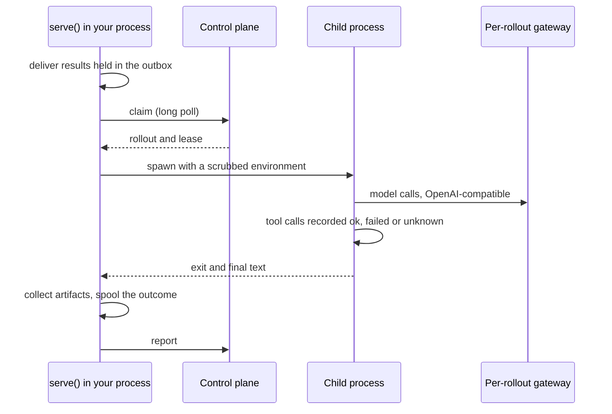

`pip install agent-flywheel` gives a Python agent two calls: `attach()` records the turns it already serves, and `serve()` works through practice tasks written for it. Your agent's code does not change. Version 0.3.0, Python 3.10 to 3.13, one runtime dependency (`httpx`). Agent is a binary? See [CLI agents](/cli-agents).

<Image src="https://raw.githubusercontent.com/percepteye-ai/agent-flywheel/main/docs/assets/flywheel-overview.gif" alt="Your agent, with its prompt, tools and model, inside your infrastructure. fw.serve() wraps it from the outside with zero lines changed inside. Rollouts and observed outcomes go out, a trained policy comes back, and the model row flips to a policy trained on this agent's own work." width="1280" height="720" />

## Install and get a key

<Steps>
<Step title="Install the SDK" icon="download">

```bash
pip install agent-flywheel
```

</Step>
<Step title="Get the agent's key" icon="key">

Let the terminal fetch it. The command prints a short code and opens launch.percepteye.ai with the code filled in; sign in, check the code matches, and click **Approve**.

```bash
agent-flywheel login --agent-id support-agent
```

The key is stored in `~/.percepteye/credentials.json` (or `$PERCEPTEYE_HOME/credentials.json`), readable only by you, for that one agent on that one control plane. Or copy it from [launch.percepteye.ai](https://launch.percepteye.ai/onboard/agent-sdk) and export it:

```bash
export PERCEPTEYE_API_KEY=pefw_...
```

The key is bound to that agent, so pass the same name as `agent_id=` in code. The control-plane URL defaults to `https://launch.percepteye.ai/api/flywheel/v1`; `PERCEPTEYE_CONTROL_PLANE_URL` or `control_plane_url=` points elsewhere.

</Step>
</Steps>

<Callout kind="info">

A stored key is consent to send, exactly as the variable is. It is used whenever no `api_key=` is passed and `PERCEPTEYE_API_KEY` is unset. `agent-flywheel logout --agent-id support-agent` forgets it on this machine; revoking it in Mission Control (**Settings**) stops it everywhere. See [Authentication](/authentication).

</Callout>

## Two calls, two processes

| | `attach()` | `serve()` |
|:--|:--|:--|
| goes in | the process serving your users | a process you lend to practice tasks |
| does | records each served turn: the user's message, every tool outcome, the answer | claims practice tasks, runs each in a fresh child process, reports the result |
| registers as | `mode: "production"` | `mode: "rollout"` |
| gated by `PERCEPTEYE_AGENT_MODE` | no | yes: `production` returns `0` before opening any connection |
| without a key | records to disk, sends nothing | offers to create one at a terminal, otherwise raises before the first rollout |
| when something breaks | fails open: the turn still runs | raises before the first rollout, never mid-run |

Both bind the same adapters (below) and write the same trajectory format with the same tri-state [outcomes](/outcomes). How the mode switch works is in [Training and production](/modes).

## Record production turns with `attach()`

Call it once at startup, then scope each turn:

```python
import agent_flywheel as fw

px = fw.attach(agent_id="support-agent", trajectory_root="/var/lib/percepteye")

with px.turn(task_id=case_id, conversation_id=conv_id,
             input_text=user_text) as turn_id:
    reply = agent.invoke(user_text)      # your agent, unmodified

px.record_answer(turn_id, reply)         # after the scope closes: the answer exists now
```

**It captures. It never reroutes.** Adapters bind with no endpoint at all, so attaching cannot re-point production traffic. An unreachable control plane costs you the observation and nothing else.

- **A turn boundary is declared, not inferred.** Keep the yielded id: it is the join key for any outcome that arrives later. Give every turn of one conversation the same `conversation_id`.
- **The turn's text is yours to pass.** `input_text=` is what the user asked; `record_answer()` is what your agent finally said, callable after the scope closes. A turn with no recorded answer is held back by the periodic upload and is kept but not learned from.
- **`task_id=` is correlation evidence, not authority.** The opaque id of your case, job or ticket is persisted, included in the upload and emitted as `percepteye.task.id`. It grants no training eligibility.
- **Nothing in `turn()` can fail the turn.** If the directory cannot be created, capture is skipped and the body still runs.

### Uploads are opt-in, twice

<Callout kind="alert">

**Upload is opt-in per agent and off by default.** A production turn is your end user's message and the answer you gave them, so nothing is sent until an org admin gives the agent [permission](/mission-control). Until then turns accumulate under `trajectory_root` and go nowhere.

</Callout>

No restart is needed when permission arrives: while the answer is no, the SDK asks again on its upload cadence. Once allowed, answered turns go every 32 turns on a short-lived daemon thread, and an `atexit` hook sends the rest. Uploads never raise into your process and never put the network on a turn's path.

```python
px.may_upload        # the live answer
px.upload_refusal    # the sentence explaining a False
px.flush()           # send now: {'sent': 1, 'skipped': 0, 'failed': 0}
```

A `flush()` result with `'not_permitted': 1` means the permission is not on yet.

**What the model saw is a second, separate opt-in, also off by default.** With message text allowed, the LangChain and Google ADK adapters also observe each model call inside a turn (system prompt, conversation history, tool definitions, every tool result) and the turn uploads it as one [OpenTelemetry GenAI](https://opentelemetry.io/docs/specs/semconv/gen-ai/) trace. Observation only: nothing is changed or truncated. Without the grant none of it is recorded, not even locally. The tier is granted only while exactly one active Product declares the agent. `px.may_capture_model_content` and `px.model_content_refusal` are the live answer and the reason.

### Your copy on disk

Every turn is a directory under `trajectory_root`, and uploading does not delete it. Left alone it grows by roughly 2.4 GB per million turns.

```python
px = fw.attach(agent_id="support-agent", trajectory_root="/var/lib/percepteye",
               retention_turns=50_000)      # keep the most recent 50k turns

px.prune(keep_last=10_000)                  # or prune when you choose
```

`retention_turns` prunes once per 256 turns, so the real ceiling is `retention_turns + 256`. `register=False` skips every control-plane call, for a process that must make no outbound connection. Records are flushed, never fsynced: they survive your process dying, not the machine losing power. Every `attach()` argument and `Attachment` member is in the [Python API reference](/reference/python). What is sent, retries and personal data are in [Production capture](/production).

## Run practice tasks with `serve()`

```python
fw.serve(
    "my_package.agent:build",
    agent_id="support-agent",
    input_shape="text",
    max_rollouts=8,
    artifacts_dir="/tmp/percepteye-first-run",
    on_event=lambda kind, ev: print(kind, ev),
)
```

`serve()` claims practice tasks, runs each in a fresh child process, reports the result, and blocks. It returns the number of rollouts that completed. Tasks arrive while a run is going, [started from your agent's page](/mission-control).

<Callout kind="tip">

Rollouts are real runs on your real credentials. **`max_rollouts` is the only clean exit:** nothing installs a SIGINT or SIGTERM handler, and Ctrl-C drains in-flight rollouts first. `artifacts_dir` defaults to `./.percepteye-artifacts`; each rollout works in `_percepteye/<rollout_id>/` beneath it, removed once reported.

</Callout>



### The entrypoint is an import path

Each rollout rebuilds your agent in a child process, and a child cannot receive a live object, so you pass a `"module:attr"` string.

| `"module:attr"` resolves to | what happens |
|:--|:--|
| a class | instantiated with no arguments |
| a zero-argument factory | called; its return value is the agent |
| an object with `invoke` / `run` / `execute` / `chat` | used as-is |
| a function that takes the task | called as a factory, so it raises `TypeError`: wrap it |

The method is probed in order (`invoke`, `run`, `execute`, `chat`, `__call__`) or named with `method=`; `async def` is awaited. `input_shape` is declared, never inferred:

| `input_shape` | your entrypoint receives |
|:--|:--|
| `"text"` | `"the task description"` |
| `"messages"` | `[{"role": "user", "content": "the task description"}]` |
| `"dict"` | `{"input": "the task description"}` |

A constructed object is accepted only under `isolation="inprocess"`, capped at `concurrency=1` with no real timeout. The default, `isolation="subprocess"`, is the only mode with a real timeout and the only one where concurrent rollouts cannot see each other's endpoint or credential.

**Your agent must sample through an OpenAI-compatible client**, because the per-rollout gateway speaks that API. Provider variables the gateway cannot serve (`AZURE_OPENAI_ENDPOINT`, `GOOGLE_API_KEY`, `GROQ_API_KEY` and the rest) are named at startup and removed from each child. A client built with an explicit `base_url` in your own code beats the environment, so build your model inside the factory.

### Misconfiguration raises before the first rollout

| step | raises when |
|:--|:--|
| resolve the mode | `PERCEPTEYE_AGENT_MODE` or `mode=` is a value it cannot parse |
| read the API key | no `api_key=`, no `PERCEPTEYE_API_KEY`, no stored key, and nobody at a terminal to create one |
| create `artifacts_dir` | the path cannot be created |
| `GET /health` | the control plane does not answer, or does not speak `flywheel/1` |
| build the runner | the entrypoint does not import, does not resolve to a callable, or does not fit the isolation mode |
| `POST /agents` | registration fails |

### Watch it with `on_event`

Without a callback `serve()` is silent, and an empty queue looks exactly like a broken route. `claim_empty` means the queue is empty; `claim_failed` means the claim itself failed.

```text
rollout_start {'rollout_id': 'r-1'}
rollout_reported {'rollout_id': 'r-1', 'grade': None, 'duplicate': False, 'exclusion': None}
claim_empty {'poll_after_ms': 500}
```

The callback runs synchronously on the thread that produced the event, and exceptions it raises are swallowed. Keep it cheap. The full event list and every `serve()` argument are in the [Python API reference](/reference/python).

## Run the approved version

These are for the agent serving your users, never for `serve()`: a practice task must sample through its gateway. Nothing reaches your agent until a person [approves it](/approval).

<Tabs>
<Tab title="Per turn" icon="refresh-cw">

```python
policy = fw.policy_source(agent_id="support-agent")

snap = policy.current()           # each turn; a cache read between refreshes
if snap.changed:                  # rebuild only on an actual change
    client = OpenAI(base_url=snap.base_url, api_key=snap.api_key)
    model = snap.model
```

**Nothing polls in the background.** The refresh runs inside your `current()` call, about every five minutes (never more often than 30 seconds), one attempt with a one-second budget. A promotion or a rollback reaches production with no redeploy. After its first success it serves stale rather than empty, so a network blip never moves you back to the untrained model; alert on `snap.stale_for_s`.

</Tab>
<Tab title="Once at startup" icon="play">

```python
kw = fw.apply_current_policy(agent_id="support-agent")
if kw:                            # {} means keep your current config
    client = OpenAI(base_url=kw["base_url"], api_key=kw["api_key"])
    model = kw["model"]
```

One `GET /policy/current`, no registration and no capture. `{}` is the answer for every reason it cannot act, logged on the `agent_flywheel` logger; it never raises into your startup. `set_env=True` also exports `OPENAI_BASE_URL` and `OPENAI_API_KEY`.

</Tab>
<Tab title="The prompt" icon="file-text">

```python
served = fw.current_prompt(agent_id="support-agent")
decision = fw.prompt_decision(served)     # may it be applied, and if not why
if decision.apply:
    system_prompt = decision.text
else:
    log.info("keeping the current prompt: %s", decision.reason)
```

The SDK never applies a prompt for you. `prompt_decision()` refuses when there is no approved text, your baseline prompt changed since the pair was approved, the status is not one a person approved, or the prompt was approved against a different checkpoint. `text` is `None` on a refusal, never `""`, so it cannot blank your prompt.

</Tab>
</Tabs>

## Adapters

LangChain, LangGraph and Google ADK agents are recorded with no Agent Flywheel code inside them. `adapters="auto"` is the default for both calls.

| adapter | distribution | versions | covers |
|:--|:--|:--|:--|
| `langchain` | `langchain-core` | `>=0.3,<2` | LangChain and LangGraph (the node name comes from run metadata) |
| `adk` | `google-adk` | `>=1,<3` | Google ADK |

| `adapters=` | behavior |
|:--|:--|
| `"auto"` | bind every built-in whose framework is installed; skip and record the rest |
| `[]` | bind nothing |
| `["langchain"]` | require it: a named adapter that cannot bind raises `RoutingNotInstallable` |

**Zero added dependencies.** No adapter imports its framework at module scope; the import happens inside `bind()`. Under `serve()` adapters bind in the child, so a named adapter that cannot bind fails each rollout as `flywheel_crash`. Under `attach()` a binding failure is swallowed.

**Shipping your own.** An adapter is a small object (`name`, `distribution`, `supported`, `required_symbols`, `capabilities()`, and a `bind()` that returns an unbind callable) that never imports its framework at module scope, reports `unknown` rather than guessing, and fails loudly at bind time. Distributions register it in the `agent_flywheel.adapters` entry-point group. Today `serve()` and `attach()` resolve adapter names against the built-ins only, so pass a third-party adapter as an instance under `isolation="inprocess"`.

## Zero instrumentation, worked end to end

This LangChain agent contains no reference to Agent Flywheel:

```python
# lc_agent.py: your existing agent, untouched
from langchain_core.tools import tool

@tool
def lookup(q: str) -> str:
    """Look something up."""
    return f"found: {q}"

class Agent:
    tools = [lookup]
    def invoke(self, task: str) -> str:
        return str(lookup.invoke({"q": task}))

def build():
    return Agent()
```

Served with `fw.serve("lc_agent:build", agent_id="support-agent", input_shape="text")`, a task whose text is `"count to three"` reports:

```json
"tool_calls": [{"name": "lookup", "arguments": {"q": "count to three"},
                "outcome": "unknown", "status_code": null,
                "output": "found: count to three", "latency_ms": 0.199}]
```

**`unknown`, not `ok`.** The tool returned a string, and raw content from a tool that worked is byte-identical to content from one that caught its own exception. Driven by a model-issued tool call, the same adapter reports `ok` with the `tool_call_id` attached, because then there is a `ToolMessage` with a real status.

## `record_tool_call` for ground truth

Where you know the answer, say it:

```python
from agent_flywheel import record_tool_call

record_tool_call("charge_card", {"amount": 4200}, outcome="ok", status_code=201)
```

`outcome` and `status_code` are keyword-only and required, so half an outcome cannot be built. It works inside a practice task and inside an `attach()` turn, and outside both it is a no-op, so the line can stay in a shared code path. To branch on where you are, use `fw.current_capture()`: `("rollout", id)`, `("turn", id)` or `None`.

## `describe=` and `introspect=False`

Once at startup the SDK reads your agent's shape: system prompt, tool names, descriptions and JSON Schemas, provider and model, and sub-agents to depth 4. Never sent: your tools' source or return values, your credentials, your data. Tasks are generated from that tool surface.

An agent nothing can read (a plain class, no framework the SDK knows) registers as unreadable and gets no tasks. Declare it:

```python
fw.serve(
    "my_package.agent:build", agent_id="support-agent", input_shape="text",
    describe={
        "system_prompt": SYSTEM_PROMPT,
        "tools": TOOLS,          # the list you already send the model
        "model": "gpt-4.1",      # optional
    },
)
```

What you declare wins over reflection; what you leave out still comes from it. `attach(describe=...)` takes the same argument, which is how a production-only agent tells the control plane its prompt and tools. Turn discovery off with `introspect=False` or `PERCEPTEYE_INTROSPECT=0` (only `0`, `false`, `no` or `off` count). `introspect=False` together with `describe=` raises.

## OpenTelemetry egress

With `pip install "agent-flywheel[otel]"`, every recorded outcome is also emitted as an `execute_tool <tool name>` span into the `TracerProvider` you already registered. The extra is the OpenTelemetry API only: the SDK never installs a provider. Spans carry the GenAI conventions plus `percepteye.tool.outcome`; an `unknown` leaves the span status unset. A turn's span carries `percepteye.turn.id` and a rollout's carries `percepteye.rollout.id`. To send spans you already have to PerceptEye instead, see [OpenTelemetry push](/opentelemetry).
