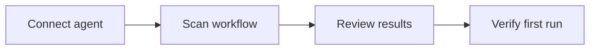

## Overview

PerceptEye AI helps you connect a workspace, observe an agent, and verify a first workflow run without a long setup cycle. This starter kit page shows the fastest path from account creation to a working integration, and you can adapt each step to your own stack.

<Callout kind="info">

This is a starter kit template. Replace the sample values, endpoints, and project names with your own environment details before sharing it with your team.

</Callout>

## Before you begin

You only need a few things to get started:

- An active PerceptEye AI account
- Permission to create a workspace
- A machine or service that can run the SDK
- Access to a test environment where you can safely scan a workflow

<Columns cols={3}>
  <Card title="Account setup" icon="users" href="#account-setup">
    Create your account and confirm access to the dashboard.
  </Card>
  <Card title="Workspace creation" icon="settings" href="#workspace-creation">
    Organize a project space before connecting any systems.
  </Card>
  <Card title="First scan" icon="search" href="#first-workflow-scan">
    Run a first discovery pass against a real workflow.
  </Card>
</Columns>

## Quickstart path

### Step 1: Create your account

Start by signing up and confirming your email address. After that, open the dashboard and create a new workspace for the team or project you want to onboard first.

### Step 2: Create a workspace

Use a workspace name that matches your deployment scope, such as a product line, environment, or team. Clear naming makes it easier to separate experiments, observability data, and future model iterations.

### Step 3: Connect your first agent

Install the SDK in the environment where your agent runs, then connect it using a workspace token from the dashboard. The sample below shows a minimal setup you can adapt for your own agent runtime.

<CodeGroup tabs="TypeScript,Python,Bash" show-lines={true}>
  ```typescript
  import { PerceptEye } from "@percepteye/sdk";

  const client = new PerceptEye({
    apiKey: process.env.PERCEPTEYE_API_KEY,
    workspaceId: "ws_prod_support"
  });

  await client.agents.connect({
    agentName: "support-router",
    version: "1.0.0"
  });
  ```

  ```python
  import os
  from percepteye import PerceptEye

  client = PerceptEye(
      api_key=os.environ["PERCEPTEYE_API_KEY"],
      workspace_id="ws_prod_support"
  )

  client.agents.connect(
      agent_name="support-router",
      version="1.0.0"
  )
  ```

  ```bash
  export PERCEPTEYE_API_KEY="YOUR_API_KEY"
  percepteye connect --workspace ws_prod_support --agent support-router --version 1.0.0
  ```
</CodeGroup>

## Installation

<Steps>
  <Step title="Install the SDK" icon="download">

  Add the SDK to your application and confirm your runtime can import it.

  ````bash
  npm install @percepteye/sdk
  ````

  </Step>
  <Step title="Configure credentials" icon="lock">

  Set your API key as an environment variable and keep it out of source control.

  ````bash
  export PERCEPTEYE_API_KEY="YOUR_API_KEY"
  ````

  </Step>
  <Step title="Register the agent" icon="rocket">

  Connect your first agent with a workspace-scoped identifier.

  ````javascript
  import { PerceptEye } from "@percepteye/sdk";

  const client = new PerceptEye({
    apiKey: process.env.PERCEPTEYE_API_KEY
  });

  await client.agents.connect({
    agentName: "support-router",
    environment: "staging"
  });
  ````

  </Step>
</Steps>

## Platform modes

Use the mode that matches your setup. If you are validating locally, keep the scan scope small. If you are onboarding a production service, prefer a staged rollout with a limited set of routes or tasks.

<Tabs>
  <Tab title="Local development" icon="terminal">

  Run the agent against a development environment and inspect the first discovery results before broadening the scope.

  ````bash
  percepteye scan --workspace ws_prod_support --target http://localhost:3000
  ````

  </Tab>
  <Tab title="Staging" icon="monitor">

  Connect to your staging system and verify that the workflow map reflects the expected services and events.

  ````bash
  percepteye scan --workspace ws_prod_support --target https://staging.example.com
  ````

  </Tab>
  <Tab title="Production" icon="shield">

  Use production only after you confirm permissions, rollout rules, and monitoring thresholds.

  ````bash
  percepteye scan --workspace ws_prod_support --target https://app.example.com
  ````

  </Tab>
</Tabs>

## First workflow scan

Run a discovery scan on a real workflow that your team already understands. A good starting point is a support ticket flow, a content moderation pipeline, or a simple retrieval agent.



The first scan should produce enough signal for you to answer three questions:

1. What workflow did the platform detect?
2. Where are the key decision points?
3. What should you verify before expanding the scope?

<Callout kind="tip">

If the first run looks noisy, narrow the scan target to one route, one queue, or one task type before you retry.

</Callout>

## Verify the first run

After the scan completes, confirm that the agent appears in your workspace and that the run contains useful operational detail. A healthy first run usually includes a workflow name, timestamps, a small set of event traces, and a clear status.

| Check | What you should see |
|-------|---------------------|
| Workspace | The new project appears in the dashboard |
| Agent | The connected agent shows an active status |
| Scan | The workflow scan completes without errors |
| Trace | You can inspect the first run details |
| Next action | You have enough data to plan a follow-up scan |

<Expandable title="What if the agent does not connect?" default-open="false">

Check the API key, confirm network access to `https://dashboard.example.com`, and make sure the workspace identifier matches the one in your configuration. If the problem continues, rotate the credential and retry the connection.

</Expandable>

## Next steps

Once your first run is verified, continue with a second workflow, add a richer dataset, or connect a different runtime. You can also expand into monitoring, training, or more advanced agent orchestration after the initial setup is stable.

<Columns cols={2}>
  <Card title="Observe runs" icon="bar-chart" href="/introduction">
    Learn how to review traces and operational signals in the platform.
  </Card>
  <Card title="Extend the setup" icon="arrow-right" href="#installation">
    Revisit the installation steps as you broaden your integration.
  </Card>
</Columns>