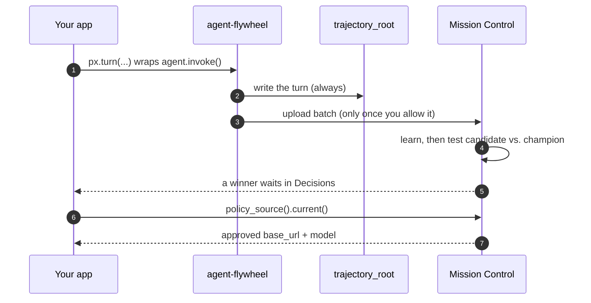

## Five minutes to your first captured turn

Pick your runtime. Every path ends the same way: your agent's real conversations arriving in Mission Control, ready to learn from, with its code unchanged.

| You need | |
| --- | --- |
| A free Mission Control workspace | Created for you during `login`, or at [launch.percepteye.ai](https://launch.percepteye.ai/onboard/agent-sdk). No credit card. |
| Python agents | Python 3.10 to 3.13, built with LangChain, LangGraph or Google ADK for full model-call capture |
| OpenClaw agents | Node 22.22.3 or later |
| Anything else that exports OpenTelemetry | Nothing to install |

<Tabs>
<Tab title="Python" icon="code">

<Steps>
<Step title="Install the SDK" icon="download">

```bash
pip install agent-flywheel
```

One runtime dependency, `httpx`. The LangChain, LangGraph and Google ADK adapters ship inside and bind automatically.

</Step>
<Step title="Get your key from the terminal" icon="key">

```bash
agent-flywheel login --agent-id support-agent
```

It prints a short code and opens Mission Control with the code filled in. Sign up or sign in, check the code matches, and click **Approve**:

```text
To connect support-agent to PerceptEye, approve this code in your browser:

    WDJB-MJHT

Opened https://launch.percepteye.ai/...
Sign up or sign in there, check the code matches, and click Approve.
Waiting for approval (the code expires in 10 min; Ctrl-C to cancel)...
Approved: a key for support-agent, saved to /home/you/.percepteye/credentials.json.
```

The key is stored readable only by you, for that one agent. In CI or a container, set it instead:

```bash
export PERCEPTEYE_API_KEY=pefw_...
```

</Step>
<Step title="Wrap each turn your agent serves" icon="code">

Call `attach()` once at startup, then wrap each turn:

```python
import agent_flywheel as fw

px = fw.attach(agent_id="support-agent", trajectory_root="/var/lib/percepteye")

def answer(conversation_id: str, user_text: str) -> str:
    with px.turn(conversation_id=conversation_id, input_text=user_text) as turn_id:
        reply = agent.invoke(user_text)          # your agent, unchanged
    px.record_answer(turn_id, reply)             # its answer, as text
    return reply
```

Inside the turn, the adapters record every model call and tool call from the outside. Each turn is written under `trajectory_root` first, and that directory is yours.

</Step>
<Step title="Allow learning, then send" icon="upload">

In Mission Control, tick **Let us learn from its conversations, including the message text**. Until then nothing is sent. No restart is needed: the SDK re-reads the permission on its own.

Turns go up every 32 answered turns and at exit. To send now:

```python
px.flush()   # {'sent': 1, 'skipped': 0, 'failed': 0}
```

`'not_permitted': 1` means the permission is not on yet, and `px.upload_refusal` says why.

</Step>
<Step title="Start improving, then approve" icon="sparkles">

On your agent's page, click **Start improving**. Each new version is tested against your agent's current best on conversations it has never seen. A version that wins waits for you in **Decisions**.

</Step>
<Step title="Run the approved version" icon="rocket">

Ask which model to run on each turn, and rebuild your client only when the answer changes:

```python
from openai import OpenAI

policy = fw.policy_source(agent_id="support-agent")

snap = policy.current()                 # each turn; a cache read between refreshes
if snap.changed:
    client = OpenAI(base_url=snap.base_url, api_key=snap.api_key)
    model = snap.model
```

Nothing polls in the background, so a promotion or a rollback reaches production with no redeploy.

</Step>
</Steps>

</Tab>
<Tab title="OpenClaw" icon="package">

<Steps>
<Step title="Install the plugin" icon="download">

```bash
openclaw plugins install @percepteye/agent-flywheel
```

No import, no wrapper process, no sidecar. Zero runtime dependencies.

</Step>
<Step title="Get your key from the terminal" icon="key">

```bash
npx @percepteye/agent-flywheel login --agent-id support-agent
```

Approve the code in your browser. The key is stored in `~/.percepteye/credentials.json`, the same file the Python SDK uses, and the plugin picks it up when neither its `apiKey` setting nor `PERCEPTEYE_API_KEY` is set.

</Step>
<Step title="Opt in and choose the mode" icon="settings">

Add this to your OpenClaw config. Set `agentId` to the OpenClaw agent this install serves; it must match the name the key was made for.

```json
{
  "plugins": {
    "entries": {
      "agent-flywheel": {
        "hooks": { "allowConversationAccess": true },
        "config": { "agentId": "support-agent", "mode": "production" }
      }
    }
  }
}
```

`allowConversationAccess` lets the plugin read your agent's answer, describe the agent, and point it at the approved model. OpenClaw drops those hooks for non-bundled plugins without it.

</Step>
<Step title="Restart and allow learning" icon="play">

Start OpenClaw the way you always do. The plugin's startup line says what state it is in. Then tick **Let us learn from its conversations, including the message text** in Mission Control; uploads start without another restart.

</Step>
<Step title="Approve, and it applies itself" icon="rocket">

Approve a winner in **Decisions**. At its next start, a production install applies both halves: the approved system prompt and the model it was certified with.

</Step>
</Steps>

</Tab>
<Tab title="OpenTelemetry" icon="radio-tower">

<Steps>
<Step title="Add the agent in Mission Control" icon="layout-dashboard">

**New mission** → **Your AI agent** → **Also send us the traces your agent already exports** → name the agent → **Create agent and get my key**. The key is shown once.

</Step>
<Step title="Point your exporter at it" icon="radio-tower">

```bash
export PERCEPTEYE_CONTROL_PLANE_URL=https://launch.percepteye.ai/api/flywheel/v1
export PERCEPTEYE_API_KEY=pefw_...
export OTEL_EXPORTER_OTLP_TRACES_ENDPOINT="$PERCEPTEYE_CONTROL_PLANE_URL/agents/support-agent/otlp/v1/traces"
export OTEL_EXPORTER_OTLP_TRACES_HEADERS="Authorization=Bearer%20$PERCEPTEYE_API_KEY"
export OTEL_EXPORTER_OTLP_TRACES_PROTOCOL=http/protobuf
```

`%20` is the space: OpenTelemetry reads these headers URL-encoded.

</Step>
<Step title="Allow learning" icon="shield-check">

Turn on both of the agent's permissions. Until both are on, every push is answered `403` and nothing in it is read. Your spans need [GenAI semantic conventions](https://opentelemetry.io/docs/specs/semconv/gen-ai/) with message content.

</Step>
</Steps>

Collector setup, status codes and limits are on [OpenTelemetry push](/opentelemetry).

</Tab>
</Tabs>

<Callout kind="info">

Running DeepSeek Harness, goose or a command-line agent? See [Choose an integration](/integrations) for the path that fits each one.

</Callout>

## Want practice tasks too?

Live conversations show Mission Control what your agent already does. Practice tasks show it more: tasks written from your agent's own tools, worked through by your agent and graded. In Python, one call claims and runs them:

```python
import agent_flywheel as fw

fw.serve(
    "my_package.agent:build",   # an importable "module:attr" factory
    agent_id="support-agent",
    input_shape="text",
    max_rollouts=8,             # bound the first run; also the clean exit
    artifacts_dir="./flywheel-runs",
    on_event=print,             # rollout_start, rollout_reported, claim_empty ...
)
```

Then, on your agent's page in Mission Control: **Advanced** → **Generate tasks and run them**.

```text
rollout_start {'rollout_id': 'r-1'}
rollout_reported {'rollout_id': 'r-1', 'grade': None, 'duplicate': False, 'exclusion': None}
claim_empty {'poll_after_ms': 500}
```

<Callout kind="alert">

Rollouts are real runs on your real credentials. Bound the first one with `max_rollouts`, and point `artifacts_dir` somewhere you don't mind it writing. Your agent must sample through an OpenAI-compatible client, because each rollout's gateway speaks that API.

</Callout>

## What just happened



Every request in that diagram starts on your side. If Mission Control is unreachable, you lose the observation and nothing else: `attach()` never raises into your serving path.

## Next

<Columns cols={3}>
  <Card title="Mission Control" icon="layout-dashboard" href="/mission-control">

  Every screen and click path you will use.

  </Card>
  <Card title="Production capture" icon="activity" href="/production">

  What is sent and when, personal data, retention.

  </Card>
  <Card title="Python SDK" icon="code" href="/python-sdk">

  Every surface: `attach()`, `serve()`, adapters and policy.

  </Card>
</Columns>
