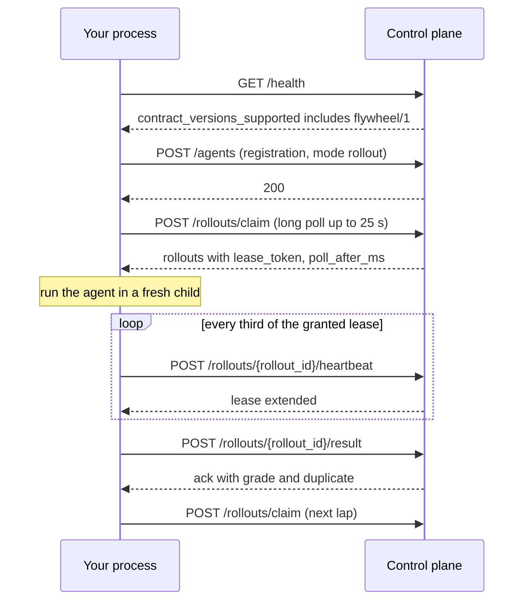

This page is for anyone building their own client or auditing what crosses the wire. Both SDKs speak exactly this; the authority is one JSON Schema file, [`schema/flywheel-1.json`](https://github.com/percepteye-ai/agent-flywheel/blob/main/schema/flywheel-1.json).

## Basics

Every route is relative to your control-plane URL, by default `https://launch.percepteye.ai/api/flywheel/v1`. Every connection is opened from your side; nothing off your machine can reach either SDK.

| Header | Value |
| --- | --- |
| `Authorization` | `Bearer pefw_...`, the agent's own key |
| `Contract-Version` | `flywheel/1` |
| `X-Percepteye-Sdk` | `agent-flywheel-python/<version>` or `agent-flywheel-node/<version>` |
| `Accept` | `application/json` |
| `Idempotency-Key` | on writes that are safe to replay; the key per route is listed below |

Bodies are JSON. Neither SDK sends a `pefw_` key inside a request body: any it finds is replaced with `pefw_[REDACTED]`.

| Schema | |
| --- | --- |
| `$id` | `https://schemas.percepteye.ai/flywheel/1.json` |
| `x-contract-version` | `flywheel/1` |
| Types | `ToolCallRecord` · `ProductionTurn` · `ProductionTurnBatch` · `Exclusion` · `RolloutRequest` · `RolloutOutput` · `ClaimResponse` · `RulebookRequest` · `RulebookReceipt` |

Server implementations pin against the published schema; the schema is never generated from a server type. `RolloutOutput` and `ToolCallRecord` are asserted by the agent. `RolloutRequest` is asserted by the control plane.

## Routes by lane

| Lane | Routes | Opened |
| --- | --- | --- |
| Register | `GET /health` · `POST /agents` · `POST /agents/{agent_id}/rulebook` (only with rules) | once, at startup |
| Claim | `POST /rollouts/claim` | in a loop, long-polled |
| Return the rollout | `POST /rollouts/{rollout_id}/heartbeat` · `/result` · `/abandon` | per rollout |
| Policy back | `GET /policy/current` · `GET /prompt/current` | at startup, or on a TTL |
| Live evidence | `POST /agents` · `GET /policy/current` · `GET /agents/{agent_id}/capture` · `POST /turns` with consent only · `POST /agents/{agent_id}/rulebook` (only with rules) | at startup, then every 32 turns and at exit |
| Pushed traces | `POST /agents/{agent_id}/otlp/v1/traces` | whenever your exporter sends |

## One rollout, end to end



## `GET /health`

Called once at startup. The response names the contracts it serves in `contract_versions_supported` (or a single `contract_version`). If `flywheel/1` is not among them, the Python SDK refuses to start: `control plane speaks [...], this SDK speaks flywheel/1. Upgrade agent-flywheel.`

## `POST /agents`

Registers the agent. `Idempotency-Key: reg-{agent_id}`. A practice-task process sends `"mode": "rollout"`; a production reader (`attach()`, or the Node plugin in production) sends `"mode": "production"`.

```json
{
  "agent_id": "support-agent",
  "mode": "rollout",
  "sdk": "agent-flywheel-python/0.3.0",
  "contract_version": "flywheel/1",
  "reports_tool_calls": false,
  "isolation": "subprocess",
  "concurrency": 1,
  "input_shape": "text",
  "entrypoint": "invoke",
  "discovered_agent": {
    "agent_name": "Agent",
    "framework": "langchain",
    "source_type": "sdk_runtime",
    "role": "standalone",
    "tool_definitions": [
      {"name": "lookup", "description": "Look something up.",
       "input_schema": {"type": "object",
                        "properties": {"q": {"title": "Q", "type": "string"}}},
       "original_format": "langchain"}
    ],
    "system_prompt": "You are a research agent."
  }
}
```

| Field | Notes |
| --- | --- |
| `agent_id` | the name the key was created for |
| `mode` | `"rollout"` or `"production"`; it names the protocol this process speaks, not the deployment switch |
| `sdk` · `contract_version` | client identity and `"flywheel/1"` |
| `reports_tool_calls` · `isolation` · `concurrency` · `input_shape` · `entrypoint` | how this process runs the agent. `attach()` sends `"inprocess"`, `1` and `"attach"` |
| `discovered_agent` | the agent's description, or `null` when it could not be read. Omitted entirely only under `PERCEPTEYE_INTROSPECT=0`, which the control plane records as your opt-out |
| `agent_execution_sha256` | optional, only when an exact execution identity exists |

Never sent: your tools' source or return values, your credentials, or anything observed during a rollout.

**The response carries the capture verdict** under `capture`: `turns` (exactly `true` means turns may be uploaded), `model_content` (exactly `true` means model content may be too), and `reason` / `model_content_reason` when either is withheld. A response with no `capture` block is not consent. The same block comes back from `GET /agents/{agent_id}/capture`, a plain read the SDKs use to notice a grant without re-registering.

## `POST /agents/{agent_id}/rulebook`

Declares the workflow rules of the one Product that declares this agent. The Product is never named on the wire.

```json
{"rules": ["Before issuing a refund, confirm the order number with the customer."]}
```

Strings only, one prose rule per string. `[]` retracts the rulebook in force. `Idempotency-Key: rulebook-{agent_id}-{digest of the body}`, and replay is safe: rules equal to the ones in force are answered `unchanged`. The control plane refuses `422 rulebook_invalid` (naming the cause and the rule's index) and `409 rulebook_unattributed` (no single Product declares the agent).

<ResponseField name="status" type="'registered' | 'retracted' | 'unchanged'" required="true">

A new version with rules, a new version with none, or nothing registered because the rules equal the ones in force.

</ResponseField>

<ResponseField name="product_id" type="string" required="true">

The Product the rules were filed under.

</ResponseField>

<ResponseField name="version_id" type="string | null" required="true">

The new version's id.

</ResponseField>

<ResponseField name="version" type="integer | null" required="true">

The version number, 1 or more.

</ResponseField>

<ResponseField name="content_sha256" type="string | null" required="true">

The digest of the version document.

</ResponseField>

<ResponseField name="parent_sha256" type="string | null" required="true">

The digest of the version it replaced. The four version fields are all `null` only for an `unchanged` retraction of a Product that never had rules.

</ResponseField>

<ResponseField name="rule_count" type="integer" required="true">

How many rules are in force.

</ResponseField>

## Claim, leases and redelivery

### `POST /rollouts/claim`

```json
{"agent_id": "support-agent", "max": 1, "wait_ms": 25000, "lease_ms": 1800000}
```

| Field | Clamped to | Notes |
| --- | --- | --- |
| `max` | 1 to 16 | never more than the slots you still intend to run |
| `wait_ms` | 0 to 25000 | the long-poll window; the HTTP timeout is `wait_ms / 1000 + 10` seconds |
| `lease_ms` | 1000 to 1800000 | 30 minutes by default |
| `agent_execution_sha256` | optional | sent only when registration carried one |

The response is a `ClaimResponse`: `rollouts` (a list of `RolloutRequest`) and `poll_after_ms`. An empty queue answers `200` with an empty list and a server-chosen `poll_after_ms`, never a bare `204`.

**A claim is not replayable.** The control plane does not honour `Idempotency-Key` on this route, so a claim that may have been processed is never resent; only a failure that provably never reached the server (a connect error or connect timeout) is retried.

### RolloutRequest

| Field | Required | Notes |
| --- | --- | --- |
| `rollout_id` | yes | minted by the control plane before the agent runs anything |
| `turn_input` | yes | the task |
| `llm_url` | yes | per-rollout, single-use gateway URL |
| `api_key` | yes | single-use, for that gateway |
| `artifacts_dir` | yes | where the rollout's files go |
| `deadline_ts` | yes | bounds the work; the timeout is computed from this, never from a local variable |
| `lease_expires_ts` | no | absolute epoch seconds at which the granted lease expires |
| `lease_token` | no | proves the lease on heartbeat, result and abandon |
| `metadata` | no | free-form; carries `completion_gate` for a CLI agent |

There is deliberately no `environment` key, and the Python SDK raises `ContractViolation` if one appears. Configuration reaches the agent only through a fresh child's environment at spawn.

### Heartbeats

`POST /rollouts/{rollout_id}/heartbeat` with `{"lease_token": ..., "extend_ms": ..., "progress": ...}`. `extend_ms` is at most 600000 (10 minutes) and `progress` is optional. The Python SDK beats each rollout at one third of the lease the server actually granted (`lease_expires_ts`), computed once at claim, floor 1 second, so two beats can be lost before anything lapses. A heartbeat extends the lease; it never moves `deadline_ts`.

**A `410` from any call means the lease is gone.** The Python SDK raises `LeaseLost`, emits `lease_lost` and kills the child. Stop working on the rollout, but keep its result: it is spooled, not discarded.

### `POST /rollouts/{rollout_id}/result`

The body is a `RolloutOutput`, with the lease token in the `X-Percepteye-Lease-Token` header and `Idempotency-Key: result-{rollout_id}`. An identical replay is acknowledged as a duplicate rather than double-counted. The acknowledgement carries `grade` and `duplicate`.

| Field | On the wire |
| --- | --- |
| `final_text` | always |
| `tool_calls` | always, including `null` |
| `tool_calls_omitted_count` | always; non-zero forbids a training grade |
| `artifacts` | always; name to digest, or `{sha256, size_bytes, content}` for a small UTF-8 file |
| `events` · `timing` | always |
| `llm_call_count` | only when set |
| `reward` | only when set; advisory |
| `success` | only when set |
| `agent_fingerprint` | only when set |
| `exclusion` | `{"reason": ..., "detail": ...}`, only when the rollout is excluded |

That is the complete set; the schema sets `additionalProperties: false`. Every rollout is reported, whatever happened to it, with its exclusion when it has one.

| Exclusion `reason` | Means |
| --- | --- |
| `flywheel_crash` | the SDK's own failure |
| `substrate_unavailable` | every observed tool call failed |
| `credential_expired` | the lease lapsed mid-rollout |
| `deadline_exceeded` | the budget was gone before or during the run |
| `entrypoint_error` | the Python entrypoint raised; nothing usable ran |
| `agent_exit_nonzero` | a command agent ran and exited non-zero |
| `cancelled` · `capacity` | the control plane's vocabulary; neither SDK emits them |

### `POST /rollouts/{rollout_id}/abandon`

`{"lease_token": ..., "reason": ..., "detail": ...}` with `detail` truncated to 2000 characters and `Idempotency-Key: abandon-{rollout_id}`. It gives the work back as "do not train on this", not as a low reward.

### Redelivery

A killed worker needs no cleanup call. In-flight rollouts are orphaned, and the control plane reclaims them by lease expiry, up to 30 minutes, then hands them to the next claimer. On the client side, a result is written to a durable outbox before it is sent, and held results are delivered before the next claim. A refusal that resending cannot fix is retired, never deleted.

## Retries

Both SDKs give each request up to four attempts, with a 30-second timeout each.

- `429` is always retried, after `Retry-After` (capped at 8 seconds) or a jittered backoff.
- `408`, `500`, `502`, `503`, `504` and a dropped connection are retried, except on a claim.
- Any other `4xx` is final.

## `GET /policy/current`

What model this agent should run. A read: the agent is told its arm and never chooses one.

```json
{
  "arm": "...",
  "reason": "...",
  "endpoint": {"base_url": "...", "model": "...", "api_key_env": "PERCEPTEYE_API_KEY"},
  "serving_generation": "...",
  "ttl_s": 300
}
```

<ResponseField name="endpoint" type="object | null" required="false">

`base_url`, `model`, and either `api_key` (a credential the control plane sends) or `api_key_env` (the variable to read it from). `null` or absent means nothing is deployed: keep what you run.

</ResponseField>

<ResponseField name="withdrawn" type="boolean" required="false">

Exactly `true` means the policy served earlier is taken back: run your own configuration again.

</ResponseField>

<ResponseField name="serving_generation" type="string" required="false">

Moves when anything about what to run moves, the prompt included.

</ResponseField>

<ResponseField name="ttl_s" type="number" required="false">

A refresh hint. It wins over the client's own TTL; the 30-second floor wins over both.

</ResponseField>

<ResponseField name="arm" type="string" required="false">

Which arm the agent is on. Informational; the agent never chooses it.

</ResponseField>

<ResponseField name="reason" type="string" required="false">

Why, in the control plane's words. Logged when a policy is withdrawn.

</ResponseField>

**A withdrawal** is `withdrawn: true` with `endpoint: null`, and wins over any endpoint beside it:

```json
{"withdrawn": true, "endpoint": null}
```

A `null` endpoint without the flag is not a withdrawal; it means keep what you run. Both SDKs ask the same questions in the same order: withdrawn, then an address and a model, then whether `model` is a stored artifact (`gs://`, `s3://`, `file://`, `/`) rather than a servable name, then the credential. When `api_key_env` is `PERCEPTEYE_API_KEY`, the flywheel key is sent only to an endpoint at the control plane's own origin.

## `GET /prompt/current`

The approved system prompt, as a separate read because the policy is polled and a prompt is unbounded text. `{}` means keep the prompt you have.

| Field | Meaning |
| --- | --- |
| `name` · `version` · `text` | the deliverable |
| `sha256` | the prompt's own identity |
| `candidate_kind` · `status` | for example `"replacement"`, `"approved"`; only `approved` and `delivered` may be applied |
| `model_prompt_checksum` | the prompt identity stamped on the model when the pair was certified |
| `stale_baseline` | `true` when the baseline prompt changed after certification |

The decision rule is [`prompt_decision()`](/reference/python).

## `POST /turns`

Uploads captured production turns, **with consent only**: a client sends nothing here until the capture verdict says `turns: true`.

```json
{"agent_id": "support-agent", "turns": [
  {"turn_id": "t_0123456789abcdef", "conversation_id": "conv-42",
   "turn_index": 0, "input_text": "Where is my order?", "final_text": "It ships today.",
   "tool_calls": [], "tool_calls_omitted_count": 0}
]}
```

A batch holds 1 to 64 turns. `Idempotency-Key: turns-{agent_id}-{digest of the turns}`. The server keys each turn on organization, agent and `turn_id`, and answers a resubmission as a duplicate, so retrying an ambiguous send is safe.

| `ProductionTurn` field | Required | Notes |
| --- | --- | --- |
| `turn_id` | yes | 1 to 255 characters; no edge whitespace, control characters, `/`, `\`, `.` or `..` |
| `input_text` · `final_text` | yes, nullable | what the user asked and what the agent answered |
| `tool_calls` | yes, nullable | `null` means not reported; `[]` means zero calls observed |
| `tool_calls_omitted_count` | yes | unreadable records |
| `conversation_id` · `turn_index` | no | ordering within a conversation |
| `task_id` | no | opaque caller correlation; never a success label or permission to train |
| `agent_fingerprint` | no | exact execution identity |
| `occurred_at` | no | RFC 3339 time the agent produced the turn |
| `genai_trace` | no | one OTLP/JSON trace of what the model saw and said; only under the model-content consent tier |

A `403` is a refusal (capture switched off, or a key without the `turn.report` scope), not a blip: the SDKs stop uploading, keep the turns on disk, and pick up again when consent returns. A per-turn reply can refuse a `genai_trace` by name (`model_content_capture_not_enabled`, `genai_trace_turn_not_attributed_to_a_product`), and the SDKs stop recording model content when it does.

## `POST /agents/{agent_id}/otlp/v1/traces`

The OpenTelemetry push endpoint, per agent, authenticated with that agent's own key. It takes an OTLP `ExportTraceServiceRequest` as `application/x-protobuf` or `application/json`, optionally gzipped. It never registers an agent. Statuses and setup are on [OpenTelemetry push](/opentelemetry).

## Tool-call record

One executed tool call (`ToolCallRecord`), one JSON object per line of `tool_calls.jsonl` and one entry of `tool_calls` on the wire. `additionalProperties: false`.

<ResponseField name="name" type="string" required="true">

The tool name. Non-empty.

</ResponseField>

<ResponseField name="arguments" type="object" required="false">

The arguments the tool ran with.

</ResponseField>

<ResponseField name="outcome" type="'ok' | 'failed' | 'unknown'" required="true">

No default. `unknown` is the honest answer when nothing observed a verdict, and is never rounded up to `ok`. Server-side it maps to true, false and null, and verifiers that depend on it abstain on null.

</ResponseField>

<ResponseField name="status_code" type="integer | null" required="true">

A required key with a nullable value: the HTTP status observed, 100 to 599, or `null`. Must be `null` when `outcome` is `unknown`.

</ResponseField>

<ResponseField name="output" type="any" required="false">

The tool result, scrubbed of machine-readable status when `outcome` is `unknown`. The Node plugin never writes it.

</ResponseField>

<ResponseField name="error" type="string | null" required="false">

The error text, when there was one.

</ResponseField>

<ResponseField name="error_class" type="string | null" required="false">

A short class for the error, such as `ToolError` or `ExitStatus:3` from the Node plugin.

</ResponseField>

<ResponseField name="latency_ms" type="number | null" required="false">

How long the call took, 0 or more.

</ResponseField>

<ResponseField name="agent_name" type="string | null" required="false">

Which agent in a multi-agent system made the call. `null` means unattributed, not that one agent made everything.

</ResponseField>

<ResponseField name="tool_call_id" type="string | null" required="false">

The id the model assigned to the call. It reappears on the `role="tool"` message of the agent's next request, which is how a call is placed after the completion that emitted it. `null` means the framework exposed none; the call still counts.

</ResponseField>

<ResponseField name="entity_ids" type="object" required="false">

The identity a write produced, under `id`, `key`, `uuid`, `sid` or `gid` only, each a non-empty string. Absent or empty means no identity evidence, which is an abstention, never a failure.

</ResponseField>

## Absence is never zero

Not reported and reported-as-nothing are different facts, and the wire keeps them apart.

| Value | Means | Does not mean |
| --- | --- | --- |
| `tool_calls: null` | tool calls were not reported | the agent made none |
| `tool_calls: []` | zero tool calls were observed, a positive assertion | nothing was looked at |
| `tool_calls: [...]` | exactly these, never a partial list | |
| `status_code: null` | no status was observed | the call had no status |
| `discovered_agent: null` | the agent could not be described | it has no tools |
| `tool_definitions: null` vs `[]` | could not look, versus looked and found none | |

If any executed call cannot be classified, send it with `outcome: "unknown"`, or send the whole list as `null`. A truncated list is indistinguishable from a short one.
