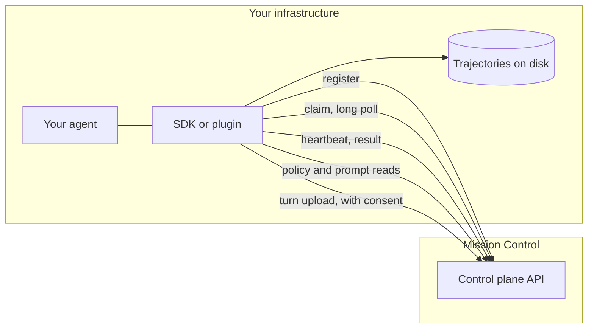

This page lists every connection the SDK and the Node plugin open, what crosses each one, and how practice rollouts are isolated on your machine. The short version: everything dials out, nothing dials in.



Every arrow is a request your process makes. Answers come back on the connection you opened.

## Every lane is outbound

That is not a deployment convenience. It is what makes the package installable inside a corporate network without a change request.

| lane | routes | opened |
|:--|:--|:--|
| **⓪ register** | `GET /health`, `POST /agents`, `POST /agents/{agent_id}/rulebook` (only with `rules=`) | once, at startup |
| **① claim** | `POST /rollouts/claim` | in a loop, long-polled |
| **② return the rollout** | `POST /rollouts/{id}/heartbeat`, `/result`, `/abandon` | per rollout |
| **③ policy back** | `GET /policy/current`, `GET /prompt/current` | at startup, or on a TTL |
| **④ live evidence** | `POST /agents`, `GET /policy/current`, `POST /agents/{agent_id}/rulebook` (only with `rules=`), capture to disk, `POST /turns` **with consent only** | at startup, then every 32 turns and at exit |

Lanes ① and ② exist only in training mode. A Python `serve()` in production mode returns before opening any connection, and `attach(..., register=False)` opens none at all. Terminal login (`agent-flywheel login`) is outbound too: it posts to the control plane's device-login routes and polls for the approval.

With no key, nothing leaves the machine. The Node plugin still records your agent's real tool-failure rate locally, with no account and no network.

## Nothing dials in

There is no inbound port, no public DNS record and no TLS termination on your side. You can check:

<CodeGroup tabs="Node plugin,Python SDK">

```bash
# in a checkout of agent-flywheel-node
grep -rnE "createServer|\.listen\(" src/          # no matches, exits 1
```

```bash
# in a checkout of agent-flywheel
grep -rnE "\.listen\(|HTTPServer|uvicorn|fastapi|flask" src/
# one match, in src/agent_flywheel/host_description.py:
#   http.server.ThreadingHTTPServer(("127.0.0.1", 0), _Handler)
```

</CodeGroup>

The one match in the Python SDK is a loopback observer bound to `127.0.0.1` on an ephemeral port. It runs only during a command agent's one-time describe warm-up (see below), answers that child with an inert reply, forwards nothing, and is closed when the warm-up ends. Nothing off the machine can reach it.

## How a practice rollout is isolated

This applies to the Python SDK's `serve()`. Each rollout runs in a **fresh child process** with a **single-use credential**, and its configuration crosses into that child at spawn, never into your running process.

| rule | effect |
|:--|:--|
| the inherited `PERCEPTEYE_` namespace is scrubbed completely | the long-lived control-plane key stays in the parent, never in a process running agent code |
| two rollout-scoped values are set | `PERCEPTEYE_ROLLOUT_ID` and `PERCEPTEYE_TRAJECTORY_DIR` |
| routing is set last | `OPENAI_BASE_URL`, `OPENAI_API_BASE`, `OPENAI_API_KEY`, `ANTHROPIC_BASE_URL`, `ANTHROPIC_API_KEY` point at the per-rollout gateway with its single-use key, and beat anything inherited |
| unroutable provider variables are removed | your agent cannot quietly sample a provider the gateway does not see |
| the rest of your environment passes through | your agent needs your credentials; that is the premise of running it in your process |

`serve()` warns at startup when it finds an unroutable provider variable set. An agent that then finds no provider configured raises in front of the person who configured it, which is the intended outcome. Silent off-gateway sampling is the one that must not happen.

<Expandable title="The provider variables removed from every child" default-open="false">

`AZURE_OPENAI_ENDPOINT`, `AZURE_OPENAI_API_KEY`, `AZURE_OPENAI_AD_TOKEN`, `OPENAI_API_TYPE`, `OPENAI_API_VERSION`, `GOOGLE_API_KEY`, `GEMINI_API_KEY`, `GOOGLE_GENAI_USE_VERTEXAI`, `NVIDIA_API_KEY`, `NVIDIA_NIM_API_KEY`, `AWS_BEARER_TOKEN_BEDROCK`, `GROQ_API_KEY`, `MISTRAL_API_KEY`, `TOGETHER_API_KEY`, `OPENROUTER_API_KEY`, `FIREWORKS_API_KEY`, `DEEPSEEK_API_KEY`, `PERPLEXITY_API_KEY`, `COHERE_API_KEY`, `XAI_API_KEY`.

Deliberately **not** `AWS_ACCESS_KEY_ID`: that is the same credential your agent may use for S3, and taking it would break agents that never touch a model through it. The list names what is known; it is not a proof of completeness. An agent that reads a different pair of names declares them with `endpoint_env=("DEEPSEEK_BASE_URL", "DEEPSEEK_API_KEY")`.

</Expandable>

**A lost lease kills the child.** When the control plane takes a lease back, the heartbeat thread kills the rollout's child rather than letting it keep working against a revoked credential. A command entrypoint runs in its own process group, in a new session, and the whole group is killed on timeout, so a spawning agent leaves nothing behind.

**Symlinks are recorded, never followed.** Every file the agent leaves in its rollout directory is collected as an artifact. A symlink is recorded as `skipped:symlink` rather than read, because `ln -s ~/.aws/credentials creds.txt` would otherwise be read at its target and inlined into the report.

### What the isolation does not cover

- **There is no filesystem sandbox.** Isolation is a process boundary and an environment scrub. A CLI agent has a real shell, so point `artifacts_dir=` outside any checkout and run untrusted agents accordingly.
- **`HOME` passes through.** Code your agent runs with a shell can read what its user can read, `~/.percepteye/credentials.json` included, as it could `~/.aws/credentials`. That is why no request body carries a Flywheel key (below).
- **argv is visible; stdin is not.** Anything in an argv is readable by other users through `ps`. `fw.TASK` puts the task text in the process table, so use it only when the CLI cannot read stdin or `PERCEPTEYE_TURN_INPUT`.
- **A client constructed with an explicit `base_url` in your own code** beats every environment variable. The control plane's reported-versus-served call count is the check that decides.

## Credentials

**No rollout credential is written to disk.** The rollout outbox sits inside a directory your agent can read, so a rollout's lease token is held only in process memory. This holds in both SDKs.

**The one stored secret is the agent key `login` saves**, in `~/.percepteye/credentials.json` (or `$PERCEPTEYE_HOME/credentials.json`), mode `0600`, replaced atomically rather than edited in place. Both SDKs read and write the same file. See [Authentication](/authentication).

**No request body carries a Flywheel key.** Tool output flows into what the SDK reports, and a tool can print whatever its user can read. So before any body leaves, both SDKs replace every key matching the shape the control plane mints, and the exact key the client authenticates with, by `pefw_[REDACTED]`.

**The agent key cannot change what your agent runs.** Moving an agent onto a candidate requires the operator role and a signed-in human identity; see [Human approval](/approval).

## Agent discovery

Once, at startup, the SDK reads the *shape* of your agent from inside its own process, so tasks can be generated from the tool surface you actually have.

| sent | never sent |
|:--|:--|
| the system prompt (the registration copy is truncated at 20,000 characters) | your tools' source code or return values |
| tool names, descriptions and JSON Schemas | your credentials |
| provider and model name | your data |
| sub-agents, to depth 4, and the framework matched | anything observed during a rollout |

The Node plugin sends what you declare in `describe` and, in training mode, the system prompt and model your host assembled. Current OpenClaw exposes no tool list, so tools stay unknown unless you declare them.

A command agent has no object to read, so it is run **once**, before registering, on the prompt `Reply with the single word: ready`. That warm-up child gets the same environment scrub as a rollout, its model endpoint is the loopback observer above with a dummy key, and it is never captured, graded or trained on. Declaring `system_prompt`, `tools` and `model` with `describe=` replaces the warm-up entirely.

**Turn discovery off** with `introspect=False` on `serve()`, `PERCEPTEYE_INTROSPECT=0`, or `introspect: false` in the Node plugin config. Only a deliberate value (`0`, `false`, `no`, `off`) disables it, so a typo leaves it on. A refusal from either the code or the environment stands.

## Recording cannot alter your agent

- **Python adapters only observe.** No model call, response or tool result is changed. `attach()` binds the adapters with no endpoint at all, so it cannot re-point production traffic.
- **Node recording hooks cannot change a run.** OpenClaw's `after_tool_call` returns `void`, and DeepSeek Harness's `tools/result` is `@mode emit` over deep-frozen objects. The tool-result mutation seams both harnesses expose are deliberately unused, in every mode.
- **The two things the Node plugin does change** are the system prompt and the model: production mode only, approved bundles only, this agent's own turns only, and off with `PERCEPTEYE_APPLY_PROMPT=0` and `PERCEPTEYE_APPLY_MODEL=0`.
- **The OpenTelemetry extra is the API only.** `pip install "agent-flywheel[otel]"` emits into the `TracerProvider` you registered and never installs one.

## Reporting a vulnerability

Please report vulnerabilities privately to **security@percepteye.ai**.
